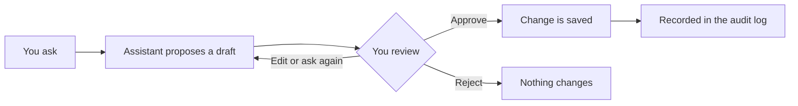

import { AGENT, PageMeta, ExampleNote, PreviewNotice, Screenshot, TryIt } from "/snippets/components.jsx";

<PageMeta tracks={["operations", "configure", "build"]} minutes={5} availability="preview" />

<PreviewNotice feature={AGENT} />

{AGENT} is the AI assistant built into the platform. It is one assistant with several capabilities: it helps you set up, drafts rules and templates, prepares cases and explains what it finds. Everything it produces is a proposal. You review it, edit it and decide.

## Why it matters

Much compliance work is gathering and drafting: collecting the transfers behind an alert, writing a first summary, turning a new instruction into a threshold. {AGENT} does that groundwork so you spend your time on the judgement. The decision stays with you, and the audit log shows who made it.

## What {AGENT} can do

You talk to the same assistant wherever you work. What it offers depends on the screen you are on and on your permissions.

| Capability | What you give it | What you get back |
| --- | --- | --- |
| Setup | Answers about your organization: licence, countries, products, reports you file | Suggested regulations to follow, first templates, starter rules and reports, ready for your review |
| Template design | A description of a kind of event, in your own words | A template with its parties and fields, plus sample events, for you to edit and accept |
| Rule writing | A monitoring goal, such as "many senders paying one recipient just under the threshold" | A rule in shadow mode, with a plain-language explanation of what it checks and when it would raise an alert |
| Integration help | The template your systems will send, and the language your developers use | Sample code to send events and receive webhooks, for your developers to review |
| Case handling | A case opened from an alert | The linked transfers, screening results and profile facts gathered in one place, proposed tasks and a draft summary |
| Explanations and narratives | An alert, or a case where you decided there is suspicion | The alert explanation in plain language, or a draft narrative for a suspicious transaction report (STR) |
| Regulatory watch | A regulation, an obligation or a news item | A plain explanation with citations, and change packages that propose draft updates to your rules and reports |

Each capability is optional. Every outcome is also reachable through the screens, without {AGENT}.

## What it works from

{AGENT} works from your own data and the platform's explanations. It cites what it uses, such as the transfers, the alert explanation or the obligation text, so you can check each claim. It does not invent facts. A claim it cannot back with your data is flagged, not presented as true.

{AGENT} sees only what you are allowed to see. It cannot open a case, a report or a customer profile that your permissions hide from you.

## How it works

Every task follows the same loop. You ask, {AGENT} proposes, you review and approve, and the result is recorded.

Drafts from {AGENT} carry a visible marker, so you can always tell them apart from work a person wrote. New rules arrive in shadow mode: they run on your real activity without raising alerts until someone activates them. Some decisions are never delegated: see [Human in the loop](/ai-assistant/human-in-the-loop).

<Screenshot name="assistant-case-draft-review" alt="A case with the assistant's draft summary open beside the linked transfers, each sentence citing its source, with Accept and Edit buttons side by side" />

## Where it appears in the 360° view

{AGENT} reads the customer profile like you do: transfers, relationships, labels, screening results and history. When it prepares a case, the facts it gathers link back to the profile they came from. Nothing it drafts changes a profile until you accept it.

## See it in the remittance example

<ExampleNote />

Teranga Transfer's rule raises one alert on Moussa Ndiaye after three transfers from three senders, each just under the 5,000,000 XOF declaration threshold. The analyst opens a case from it.

{AGENT} gathers the five transfers to Moussa, totalling 24,000,000 XOF in six days. It adds the screening match on Moussa that was cleared as a false positive and the profile of the payout agent, Point Marché Tilène. It proposes the review tasks and drafts a summary that cites each transfer by its reference, such as `SAMPLE-REMIT-0003`.

The analyst checks the citations, edits the summary and completes the tasks. The money laundering reporting officer (MLRO) then decides whether there is suspicion. {AGENT} does not make that decision.

<TryIt>
  Open the case on Moussa Ndiaye in your trial and ask {AGENT} to prepare it. Check that each fact in the draft summary links to a transfer or a profile.
</TryIt>

## Related

- [Human in the loop](/ai-assistant/human-in-the-loop): what {AGENT} does alone and what needs your decision
- [The assistant prepares the case](/tutorial/assistant-prepares-the-case): the remittance chapter, step by step
- [Cases](/guides/cases/overview): how an investigation is organized
- [Regulatory compliance](/guides/regulatory-compliance/overview): obligations and change packages
- [Glossary](/glossary): the terms used on this page
