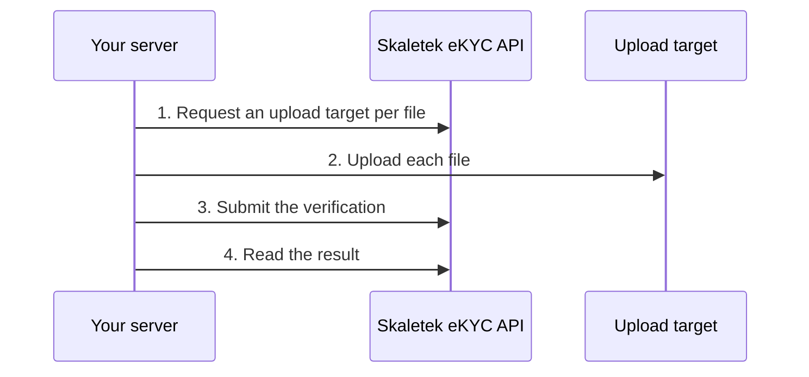

import { PageMeta, ExampleNote } from "/snippets/components.jsx";

<PageMeta tracks={["build"]} minutes={7} availability="ga" />

Use API-only verification when you already captured the person's identity document and selfie yourself, for example in your own mobile app or at a branch. You send the images from your server. Skaletek runs the checks and returns a decision. The applicant never sees a Skaletek screen.

If the person is in front of a camera right now, use the [hosted flow](/developers/ekyc/hosted-flow) instead. It guides them through capture and lets them retake a blurred photo.

<ExampleNote />

In this example, Teranga Transfer verifies Cheikh Tall, a new sender in Paris. A Teranga agent photographed his Senegalese passport and took his selfie at the branch.

## Before you start

- **API key:** a key with the **Create Identity Verifications** and **View Identity Verifications** permissions. See [Authentication](/developers/authentication).
- **Images:** the photo page of a passport, or the front and back of an ID card, plus a selfie of the same person. Read [Image requirements](#image-requirements) first.
- **A server:** call the API from your backend only. The API does not accept calls from a browser, and your API key must never reach a device.

The examples use these variables:

```bash
export KYC_API_URL="https://kyc.skaletek.example"
export SKALETEK_API_KEY="<your API key>"
```

## How it works



<Steps>
  <Step title="Request an upload target for each file">
    Call `POST /v1/uploads/presign` once per file. Name the kind of image and its format.

    ```bash
    curl -X POST "$KYC_API_URL/v1/uploads/presign" \
      -H "X-API-Key: $SKALETEK_API_KEY" \
      -H "Content-Type: application/json" \
      -d '{"artifact_type": "DOC_FRONT", "content_type": "image/jpeg"}' \
      -o presign-doc-front.json
    ```

    | Field | Required | Allowed values |
    | --- | --- | --- |
    | `artifact_type` | Yes | `DOC_FRONT` (front of the document, or the passport photo page), `DOC_BACK` (back of a two-sided document), `DOC_SINGLE`, `SELFIE`, `ADDRESS_DOC` (proof of address) |
    | `content_type` | No | `image/jpeg` (default), `image/png`, `application/pdf` |

    The response is `200 OK`:

    ```json
    {
      "artifact_type": "DOC_FRONT",
      "url": "<upload URL>",
      "fields": { … },
      "storage_key": "…"
    }
    ```

    | Field | What to do with it |
    | --- | --- |
    | `url` | Upload the file here in the next step. |
    | `fields` | Send every entry with the upload, unchanged. Treat the names and values as opaque: they differ for every upload. |
    | `storage_key` | Keep it. You cite it when you submit the verification. |

    Repeat for the selfie with `"artifact_type": "SELFIE"`, saving the response as `presign-selfie.json`. For an ID card, request `DOC_FRONT` and `DOC_BACK`.
  </Step>
  <Step title="Upload each file">
    Send a `multipart/form-data` `POST` to `url`. Add every entry of `fields` as a form field, in the order you received them. Add the file last, in a field named `file`. Don't send your API key to the upload URL.

    <CodeGroup>
    ```bash curl
    # Every entry of "fields" becomes a form field, then the file goes last.
    args=()
    while IFS= read -r field; do
      args+=(--form-string "$field")
    done < <(jq -r '.fields | to_entries[] | "\(.key)=\(.value)"' presign-doc-front.json)

    curl -s -o /dev/null -w "%{http_code}\n" \
      "$(jq -r .url presign-doc-front.json)" \
      "${args[@]}" \
      -F "file=@cheikh-tall-passport.jpg;type=image/jpeg"
    ```

    ```python Python
    import requests

    def upload(target: dict, path: str, content_type: str) -> None:
        with open(path, "rb") as f:
            response = requests.post(
                target["url"],
                data=target["fields"],  # all fields, unchanged
                files={"file": (path, f, content_type)},  # the file goes last
            )
        response.raise_for_status()  # expects 204 No Content
    ```
    </CodeGroup>

    A successful upload returns `204 No Content` with an empty body. Upload the selfie the same way.

    - The file must have the format you declared in `content_type`.
    - Files can be up to 20 MB.
    - The upload target expires after a short time. If the upload is refused, request a new target and upload again.
  </Step>
  <Step title="Submit the verification">
    Call `POST /v1/verifications/api-only` with the person's details and the storage keys of the uploaded files.

    ```bash
    DOC_FRONT_KEY=$(jq -r .storage_key presign-doc-front.json)
    SELFIE_KEY=$(jq -r .storage_key presign-selfie.json)

    curl -X POST "$KYC_API_URL/v1/verifications/api-only" \
      -H "X-API-Key: $SKALETEK_API_KEY" \
      -H "Content-Type: application/json" \
      -d '{
        "applicant_info": {
          "external_id": "TT-CUST-0004",
          "first_name": "Cheikh",
          "last_name": "Tall",
          "date_of_birth": "1987-11-23",
          "nationality": "sn",
          "email": "cheikh.tall@example.com",
          "jurisdiction": "fr"
        },
        "workflow_template": "api_only_full",
        "jurisdiction": "fr",
        "documents": [
          {
            "artifact_type": "DOC_FRONT",
            "storage_key": "'"$DOC_FRONT_KEY"'",
            "document_type": "passport",
            "issuing_country": "sn"
          }
        ],
        "selfie_artifact": "'"$SELFIE_KEY"'",
        "metadata": {"teranga_customer": "TT-CUST-0004"}
      }'
    ```

    | Field | Required | Meaning |
    | --- | --- | --- |
    | `applicant_info` | One of the two | The person's details. Skaletek creates the applicant from them. `first_name` and `last_name` are required. |
    | `applicant_id` | One of the two | The ID of an applicant you already created with `POST /v1/applicants`. |
    | `workflow_template` | No | The workflow to run. Defaults to `api_only_full`. See [Verification workflows](/developers/ekyc/workflows). |
    | `jurisdiction` | No | The country the person is verified from, as a lowercase two-letter code. |
    | `documents` | Yes | At least one document image. Each item has `artifact_type`, `storage_key`, `document_type` (for example `passport`, `national_id`, `driving_license`, `residence_permit`) and `issuing_country`. |
    | `selfie_artifact` | For workflows with a face check, such as `api_only_full` | The `storage_key` of the selfie. Skaletek compares it with the photo on the document. |
    | `metadata` | No | Your own key-value pairs, for example your customer number. |

    Country codes are lowercase ISO 3166-1 alpha-2 codes, such as `sn` for Senegal and `fr` for France. Document type codes are listed in [Reason codes and document types](/developers/ekyc/reason-codes#document-types).

    The response is `202 Accepted`. The checks run in the background.

    ```json
    {
      "verification_id": "ver_smp_0001",
      "session_id": "ver_smp_0001",
      "status": "ACCEPTED"
    }
    ```

    `verification_id` and `session_id` have the same value. Store it with your customer record.
  </Step>
  <Step title="Read the result">
    The decision arrives as an **eKYC Verification** event. Subscribe to it with a webhook, as described in [Receive verification results](/developers/ekyc/receiving-results). You can also poll `GET /v1/verifications/{verification_id}`.

    ```bash
    curl "$KYC_API_URL/v1/verifications/ver_smp_0001" \
      -H "X-API-Key: $SKALETEK_API_KEY"
    ```

    While the checks run:

    ```json
    {
      "verification_id": "ver_smp_0001",
      "session_id": "ver_smp_0001",
      "status": "IN_PROGRESS",
      "decision": null,
      "reason_codes": [],
      "evidence_bundle_id": null,
      "updated_at": "2026-10-21T10:58:09Z"
    }
    ```

    When a decision is ready:

    ```json
    {
      "verification_id": "ver_smp_0001",
      "session_id": "ver_smp_0001",
      "status": "APPROVED",
      "decision": "APPROVED",
      "reason_codes": ["POLICY_PASSED"],
      "evidence_bundle_id": "evb_smp_0001",
      "updated_at": "2026-10-21T10:59:41Z"
    }
    ```

    | Field | Meaning |
    | --- | --- |
    | `status` | Where the verification is. See [Sessions and statuses](/developers/ekyc/sessions-and-statuses). |
    | `decision` | `APPROVED`, `REJECTED` or `PENDING_REVIEW`. `null` until a decision is made. |
    | `reason_codes` | Why the verification got its decision. See [Reason codes and document types](/developers/ekyc/reason-codes). |
    | `evidence_bundle_id` | The record of the checks that your reviewers see in the dashboard. |
    | `updated_at` | When the verification last changed. |

    A `PENDING_REVIEW` decision means a reviewer on your team decides in the dashboard. See [Reviewing a verification](/guides/onboarding/reviewing-a-verification).

    If you poll, wait a few seconds between calls and back off over time. An unknown ID returns `404` with `{"type": "not_found", "message": "verification not found"}`.
  </Step>
</Steps>

## Image requirements

There is no applicant on a Skaletek screen to retake a bad photo. Check the images before you send them.

- **Real, sharp photos.** Use the original camera image. Don't send screenshots, scans of photocopies, or edited or heavily compressed images.
- **The whole document.** All four corners are visible. Nothing covers the text or the photo. There is no glare on the photo or the text.
- **Readable text.** You can read every character on the document yourself.
- **One face in the selfie.** The face is well lit, facing the camera, without sunglasses or a mask.
- **The right sides.** Send the passport photo page, or both sides of an ID card.

If Skaletek cannot read the images, the verification does not fail straight away. It stays `IN_PROGRESS`, with reason codes such as `EXTRACTION_INSUFFICIENT` or `RETAKE_REQUESTED`. Capture new images and submit a new verification.

## Testing

API-only verification has no test mode. A request with `is_demo` or `demo_expected_outcome` is rejected with `422` and `extra_forbidden`.

To build and test your result handling, use test sessions in the hosted flow. See [Testing](/developers/ekyc/testing). Never send real identity documents from a test or development system.

## Troubleshooting

| Response | Cause | Fix |
| --- | --- | --- |
| `422` with `"type": "storage_key_not_issued"` | The storage key was not issued to your account by `POST /v1/uploads/presign`. | Request an upload target, upload the file, and cite that exact `storage_key`. |
| `422` with "at least one document is required" | `documents` is empty or missing. | Add at least one document image. |
| `422` with `"type": "workflow_not_found"` | The `workflow_template` name does not exist. | Use a name from [Verification workflows](/developers/ekyc/workflows). |
| `422` with `extra_forbidden` | The body contains a field the endpoint does not accept. | Remove the field named in `loc`. |
| Stays `IN_PROGRESS` | The images could not be read. | Capture clearer images and submit again. |

See [Errors and limits](/developers/ekyc/errors-and-limits) for every error.

## Related

- [Receive verification results](/developers/ekyc/receiving-results)
- [Verification workflows](/developers/ekyc/workflows)
- [Reason codes and document types](/developers/ekyc/reason-codes)
- [Hosted flow](/developers/ekyc/hosted-flow)
- [Applicant data and privacy](/developers/ekyc/data-and-privacy)
