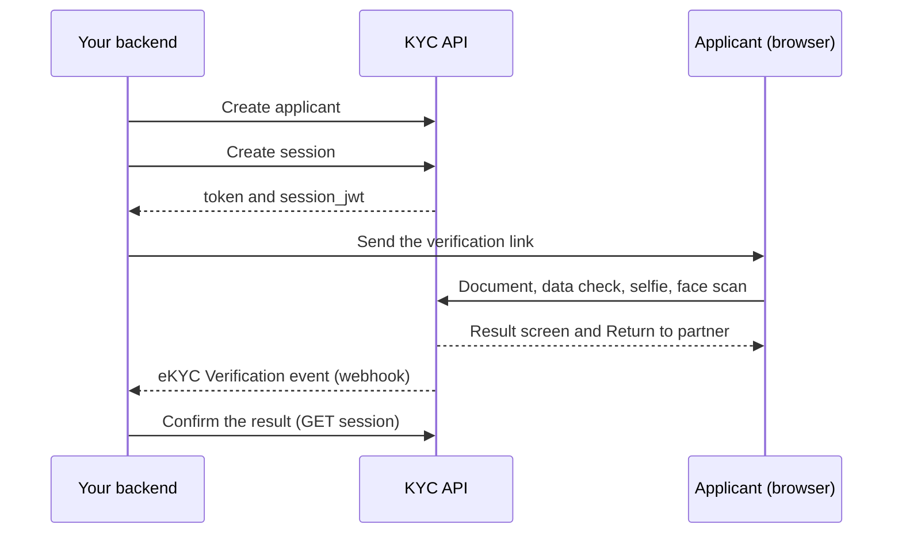

import { PageMeta, ExampleNote } from "/snippets/components.jsx";

<PageMeta tracks={["build"]} minutes={6} availability="ga" />

Electronic know your customer (eKYC) checks that a person is who they say they are. You create a verification from your backend. The person, called the applicant, takes a photo of an identity document and a selfie. Skaletek checks them and returns a decision: approved, rejected or pending review.

<ExampleNote />

In the running example, Teranga Transfer verifies each sender before their first transfer. Aminata Sow verifies her identity from Lyon with her passport.

## What a verification does for you

A standard verification runs these steps in order:

1. **Document capture.** The applicant photographs the front and, if needed, the back of an identity document. Skaletek checks the photo quality, identifies the document type and reads the details.
2. **Data check by the applicant.** The applicant checks the details read from the document and corrects them if they are wrong. Corrections are kept as evidence for your reviewers.
3. **Selfie.** The applicant takes a photo of their face.
4. **Face scan.** A short scan confirms that a live person is in front of the camera.
5. **Face comparison.** The selfie is compared with the photo on the document.
6. **Screening.** The person is screened against sanctions lists, politically exposed person (PEP) lists and adverse media.
7. **Decision.** Skaletek approves or rejects the verification, or sends it to your team for review.

The steps that run depend on the verification workflow you choose. See [Verification workflows](/developers/ekyc/workflows).

## Three ways to integrate

| Integration | How it works | Best for |
| --- | --- | --- |
| **Hosted web flow** | Your backend creates a session. You send the applicant to a link that opens the Skaletek verification pages in a browser. | Web apps, and the fastest way to go live |
| **Mobile SDK** | In preview. The Flutter SDK works with the previous version of the API today; support for these sessions is in progress. See [Flutter SDK](/developers/ekyc/flutter-sdk). | Native mobile apps built with Flutter |
| **API-only** | Your server sends document and selfie images you already collected. There is no applicant screen. | Branch scans, assisted onboarding, images captured in your own app |

Start with the hosted web flow unless you already capture the images yourself. API-only verifications skip the data check by the applicant, so the image quality is entirely up to you. See [API-only verification](/developers/ekyc/api-only).

## How the hosted flow works

1. Your backend creates an applicant with `POST /v1/applicants`. Pass your own customer number as `external_id`.
2. Your backend creates a session for that applicant with `POST /v1/applicants/{applicant_id}/sessions`. The response holds a `token` and a `session_jwt`.
3. You build the verification link from those two values and send the applicant to it.
4. The applicant completes the steps in the browser and sees the result.
5. **Return to partner** takes the applicant to your `redirect_url`.
6. Your backend learns the decision from a webhook, or by reading the session.

Every call to the KYC API comes from your backend. The KYC API does not accept calls from a browser, and your API key must never reach one.

## How results reach you

Never rely on the applicant returning to your site. Confirm every result from your backend.

| Method | What you get | When to use it |
| --- | --- | --- |
| **Platform webhook** | An `event.created` delivery for each decision, on the **eKYC Verification** event template (slug `ekyc-verification`). It carries the decision, reason codes, risk level, session ID and your `external_id`. | Your main source of results |
| **Polling** | `GET /v1/sessions/{session_id}` returns the status and decision. API-only verifications use `GET /v1/verifications/{verification_id}`, which also returns reason codes. | A check when the applicant returns, and a fallback if a webhook is missed |

eKYC decisions are delivered through the same webhooks as the rest of the platform. You set them up in **Settings** › **General Settings** › **Configurations** › **Webhook**. See [Receiving results](/developers/ekyc/receiving-results).

## Permissions

The KYC API uses the same API keys as the rest of the platform. Send the key in the `X-API-Key` header. Create the key in **Settings** › **General Settings** › **Configurations** › **API keys** › **Create keys** and pick its permissions in the **Permissions** list. See [Authentication](/developers/authentication).

| Permission in the dashboard | Code | Allows |
| --- | --- | --- |
| **Create Identity Verifications** | `ekyc:write` | Create applicants and verification sessions |
| **View Identity Verifications** | `ekyc:read` | Read applicants, sessions and verification results |
| **Review Identity Verifications** | `ekyc:review` | Approve, reject, escalate or request more evidence in the dashboard |
| **Manage Identity Verification Workflows** | `ekyc:admin` | Create and publish verification workflows, and change eKYC settings |

A server integration needs **Create Identity Verifications** and **View Identity Verifications**. Reviewing and workflow management are done by people in the dashboard.

## Testing

There is no separate test environment. You test in your account with test sessions: set `is_demo` to `true` when you create a session. The applicant goes through every screen, but the checks are simulated and you choose the outcome. Test sessions work for the hosted flow, not for API-only verifications. See [Test your integration](/developers/ekyc/testing).

## Next steps

<CardGroup cols={2}>
  <Card title="eKYC quickstart" icon="rocket" href="/developers/ekyc/quickstart">
    Run a test verification for Aminata Sow in about 15 minutes.
  </Card>
  <Card title="Hosted verification flow" icon="window-maximize" href="/developers/ekyc/hosted-flow">
    Build the link, deliver it and handle the return.
  </Card>
  <Card title="Sessions and statuses" icon="list-check" href="/developers/ekyc/sessions-and-statuses">
    Every status and decision, and which endpoint returns what.
  </Card>
  <Card title="Receiving results" icon="bell" href="/developers/ekyc/receiving-results">
    Subscribe to the eKYC Verification event.
  </Card>
</CardGroup>
