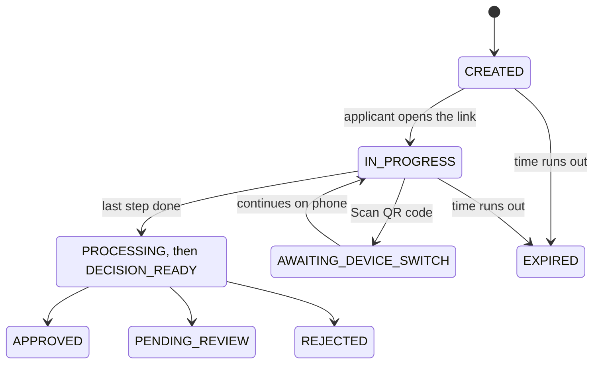

import { PageMeta } from "/snippets/components.jsx";

<PageMeta tracks={["build"]} minutes={6} availability="ga" />

A session is one attempt to verify an applicant. Each session has a type, a status that changes as the applicant progresses, and a decision once the checks are done. This page lists them all.

## Session types

`session_type` tells you how the session was created.

| Type | Created by | What it verifies |
| --- | --- | --- |
| `KYC` | `POST /v1/applicants/{applicant_id}/sessions` | A full identity verification in the hosted flow. |
| `STEP_UP` | `POST /v1/stepup` | A new selfie and face scan, compared with the applicant's verified face. See [Step-up verification](/developers/ekyc/step-up). |
| `API_ONLY` | `POST /v1/verifications/api-only` | Images your server sends, with no applicant screens. See [API-only verification](/developers/ekyc/api-only). |
| `REFRESH` | Skaletek | A new document for an applicant whose document needs renewing. This type may appear in responses. |

## Statuses

`status` is where the session is now. Act only on a final status.

| Status | Meaning | Final |
| --- | --- | --- |
| `CREATED` | The session exists. The applicant has not opened the link yet. | No |
| `IN_PROGRESS` | The applicant is going through the steps. | No |
| `AWAITING_DEVICE_SWITCH` | The applicant is moving from a computer to a phone with **Scan QR code**. | No |
| `PROCESSING` | The applicant has finished. The checks are running. | No |
| `DECISION_READY` | The checks are done. The decision is being recorded. | No |
| `APPROVED` | The identity is verified. | Yes |
| `REJECTED` | The identity could not be verified. | Yes |
| `PENDING_REVIEW` | A person in your team must decide. | No, waiting for a reviewer |
| `EXPIRED` | The session ended before the applicant finished. | Yes |

These statuses are also part of the schema and may appear. Do not build logic that depends on when they occur.

| Status | Meaning |
| --- | --- |
| `ABANDONED` | The session was cancelled before it finished. Treat it like `EXPIRED`. |
| `REQUIRES_REFRESH` | A previously verified applicant needs to verify again, for example because a document expired. |
| `STEP_UP_IN_PROGRESS`, `STEP_UP_COMPLETED`, `STEP_UP_FAILED` | Progress of a step-up verification. |

Treat any status you do not recognize as not final, and keep waiting for a decision.

## Decisions

`decision` is the outcome. It is `null` until the checks are done.

| Decision | What to do |
| --- | --- |
| `APPROVED` | Continue onboarding the customer. |
| `REJECTED` | Do not onboard the customer on this verification. You can offer a new session or another route, according to your policy. |
| `PENDING_REVIEW` | Wait. A reviewer decides in the dashboard under **Verifications** › **Individual**. Do not treat it as approved. |
| `STEP_UP_REQUIRED` | May appear. Ask the applicant for a step-up verification. |
| `null` | No decision yet. |

When a session reaches a decision, `status` and `decision` hold the same value, for example `APPROVED` and `APPROVED`.

## How a session moves



- An unfinished session becomes `EXPIRED` when its `expires_at` time passes. Create a new session to try again.
- `PENDING_REVIEW` waits for a person. The reviewer approves or rejects the verification in the dashboard. See [Reviewing a verification](/guides/onboarding/reviewing-a-verification).

## Which endpoint returns what

| Source | Status and decision | Reason codes | Risk level |
| --- | --- | --- | --- |
| `GET /v1/sessions/{session_id}` | Yes | No | No |
| `GET /v1/applicants/{applicant_id}/sessions` | Yes, for every session of the applicant | No | No |
| `GET /v1/verifications/{verification_id}` (API-only) | Yes | Yes | No |
| eKYC Verification event, by webhook | Yes | Yes | Yes |

Reason codes explain a decision, for example `POLICY_PASSED`. See [Reason codes](/developers/ekyc/reason-codes).

### Session summary

`GET /v1/sessions/{session_id}` returns the session summary.

```json
{
  "id": "ses_smp_0001",
  "applicant_id": "app_smp_0001",
  "session_type": "KYC",
  "status": "PENDING_REVIEW",
  "decision": "PENDING_REVIEW",
  "evidence_bundle_id": "evb_smp_0001",
  "expires_at": "2026-10-21T11:48:30.319083Z",
  "created_at": "2026-10-21T10:48:30.307036Z"
}
```

| Field | Meaning |
| --- | --- |
| `id` | The session ID. |
| `applicant_id` | The applicant the session belongs to. |
| `session_type` | See [Session types](#session-types). |
| `status` | See [Statuses](#statuses). |
| `decision` | See [Decisions](#decisions). `null` until decided. |
| `evidence_bundle_id` | The evidence collected in the session, or `null` before the checks run. Reviewers see the evidence in the dashboard. |
| `expires_at` | When an unfinished session expires. |
| `created_at` | When the session was created. |

### All sessions of an applicant

`GET /v1/applicants/{applicant_id}/sessions` lists the applicant's sessions, newest first. It takes `limit` (1 to 100, default 50) and `offset`.

```json
{
  "items": [
    {
      "id": "ses_smp_0001",
      "applicant_id": "app_smp_0001",
      "session_type": "KYC",
      "status": "APPROVED",
      "decision": "APPROVED",
      "evidence_bundle_id": "evb_smp_0001",
      "expires_at": "2026-10-21T11:51:29.373508Z",
      "created_at": "2026-10-21T10:51:29.353235Z"
    }
  ],
  "page": {"limit": 50, "offset": 0, "total": 1}
}
```

## Polling

Webhooks are the main way to receive results. Poll only to check a result when the applicant returns to your site, or as a fallback if a webhook is missed.

When you poll:

- Poll a single session with `GET /v1/sessions/{session_id}`, not the applicant's session list.
- Wait a few seconds between requests, and wait longer after each unchanged answer.
- Stop when the status is final, or when `expires_at` has passed and the applicant has not finished.
- Stop when the status is `PENDING_REVIEW`. A review takes as long as your team needs, so wait for the webhook instead.
- If you get `429`, wait for the number of seconds in the `Retry-After` header before you try again.

See [Receiving results](/developers/ekyc/receiving-results) and [Errors and limits](/developers/ekyc/errors-and-limits).

## Related

- [Hosted verification flow](/developers/ekyc/hosted-flow)
- [Receiving results](/developers/ekyc/receiving-results)
- [Reason codes](/developers/ekyc/reason-codes)
- [Reviewing a verification](/guides/onboarding/reviewing-a-verification)
