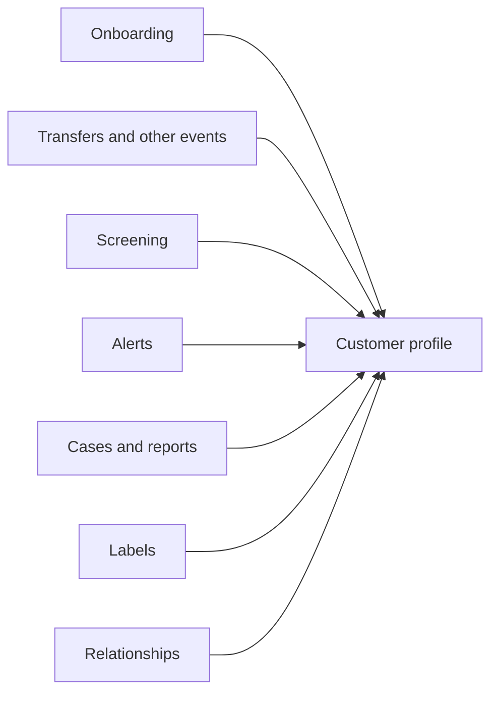

import { PageMeta, ExampleNote, Screenshot } from "/snippets/components.jsx";

<PageMeta tracks={["operations"]} minutes={4} availability="ga" />

Every person and organization you deal with has one customer profile in Skaletek. Skaletek also calls it the entity profile. Whatever you do in onboarding, screening, monitoring, investigation or reporting adds to it. When you need to understand a customer, the profile is where you go.

## Why it matters

Risk rarely shows up in one place. A transfer looks normal on its own. A near match on a sanctions list may be a false alarm. A new partner agent seems ordinary. Put together on one page, they tell a story you can act on.

The profile also saves you time. You do not search four systems or ask three teams. You open **Entities**, find the customer and see the whole history.

## What feeds the profile

| Source | What it adds to the profile |
| --- | --- |
| **Verifications** | Identity details and the result of know your customer (KYC) or know your business (KYB) checks. For an organization, its owners and the people who control it. |
| **Events** | Each transfer, payment or other activity the customer took part in, on a timeline. |
| **Screening** | Each potential match against a sanctions or watchlist, and the decision you recorded on it. |
| **Alerts** | Every alert raised on the customer, with its status. |
| **Cases** | Investigations the customer is part of, and their outcome. |
| **Report** | Reports filed to authorities that involve the customer, such as a suspicious transaction report (STR). |
| Labels | Tags you or your rules add, such as a risk level. |
| Relationships | The people and organizations the customer sends to, receives from or is linked to, shown as a graph on the **Explore** tab. |
| Lineage | For each value, such as an address, where it came from and when it changed. |

## See it in the remittance example

<ExampleNote />

Moussa Ndiaye lives in Dakar. He receives five transfers in six days, from three senders in France and Italy. Each transfer is just under the 5,000,000 West African CFA franc (XOF) declaration threshold. On his own transfers, nothing stands out. On his profile, the pattern is plain.

<Screenshot name="entities-profile-moussa-overview" alt="Moussa Ndiaye's entity page on the Details tab: his summary on the left and the Appearances table listing the five transfers he received, TT-REMIT-0001 to TT-REMIT-0005." src="/images/screenshots/entities-detail-moussa.light.en.png" />

On Moussa's profile you see:

- **Three senders:** Aminata Sow, his sister, and Fatou Ba and Cheikh Tall, who have no stated link to him.
- **One payout agent:** Point Marché Tilène paid four of his five transfers in cash.
- **A cleared screening match:** his name nearly matched an entry on the sample sanctions list. An analyst cleared it as a false positive, with the reason recorded.
- **An alert and a case:** the alert that the pattern raised, and the case opened from it.
- **Relationships:** a graph on the **Explore** tab linking Moussa to his senders and to the agent. From the agent, you reach its beneficial owner, Ibrahima Fall.
- **Lineage:** where his address came from, and when.

Chapter 8 of the tutorial, [See the whole picture](/tutorial/see-the-whole-picture), walks through his profile step by step.

## Related

- [Customer 360° guide](/guides/customer-360/overview)
- [See the whole picture (tutorial chapter 8)](/tutorial/see-the-whole-picture)
- [15-minute tour](/get-started/tour)
- [Glossary](/glossary)
