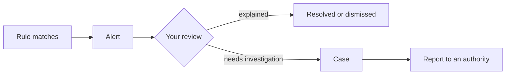

import { PageMeta, LifecycleStepper, ExampleNote, Screenshot } from "/snippets/components.jsx";

<PageMeta tracks={["operations"]} minutes={5} availability="ga" />

<LifecycleStepper current="investigate" />

An alert tells you that one of your rules found something worth a look. Each alert arrives in your inbox with an explanation: what happened, which values crossed which limits, and which events were involved. You read it, decide what it means, and either resolve it or take it further in a case.

## Why it matters

Your team's time goes where your alerts send it. A clear inbox puts the most urgent work first. A clear explanation lets you judge an alert in seconds, without rebuilding the facts from other systems.

Alerts are also your record. Every acknowledgement, assignment, note and resolution is kept. When a supervisor asks why you closed an alert, the answer is on the alert.

## How it works

A rule watches your events. When its conditions are met, Skaletek raises an alert on the customers involved and places it in **Alerts**. From there, you work it.

An alert, a case and a report answer three different questions:

| Object | Question it answers |
| --- | --- |
| Alert | Why was this raised? |
| Case | What did we investigate, and what did we decide? |
| Report | What did we file, and with whom? |

### The alert inbox

**Alerts** opens on your alerts. Tiles at the top count **Open**, **Critical**, **SLA Breached**, **At risk**, **Resolved** and **Total** alerts. You can filter by **Status**, **Severity**, **SLA**, **Rules**, **Entity**, **Templates**, **Country** and **Event status**, or search by entity identifiers.

Select an alert to see a preview: its title, the main values behind it and the first recommended step. When new alerts arrive while you work, a banner tells you how many. The list does not jump under your cursor.

### Reading an alert explanation

Every alert carries its explanation from the moment it appears. The explanation is built from your actual data and the rule's evaluation. It is not a generated guess. It shows:

- The heading: what fired, in plain words, with the rule's description below it.
- **Rule evaluation:** under **Conditions the rule evaluated**, each condition of the rule, with the value found and the limit it was compared to. A time window shows its exact start and end.
- **Entities:** under **Entities & factors**, each person or organization, with their role in the event. **Profile** opens their entity page.
- **Evidence:** a relationship graph of the events and customers involved.
- **Transactions:** under **Related Transactions**, the events involved, as a **Table**, a **Timeline** or a **Map**.
- Next steps: what supports escalating or closing, and recommended actions.

The wording stays neutral. It says "3 transfers between 4,500,000 and 5,000,000 XOF in 7 days", not "this person is structuring". The judgement is yours.

<Screenshot name="alerts-explanation-moussa" alt="The alert on Moussa Ndiaye open on the Rule evaluation tab: four conditions met, each transfer amount within 90% to 100% of the 5,000,000 XOF threshold, three transfers and three senders in 7 days, so the rule raises a high alert." src="/images/screenshots/alerts-detail-rule-evaluation.light.en.png" />

### Severity and service-level targets

Each rule sets a severity for its alerts. Each severity has a service-level agreement (SLA): a target time to respond. Your administrator can change these targets under **Settings** › **General Settings** › **Configurations** › **Compliance Configuration**.

Under **SLA window by severity**, you set the maximum time, in hours, that an open **High**, **Medium** or **Low** alert can run before it is breached and escalated.

The inbox shows the SLA state of each alert: **On track**, **At risk** as the deadline nears, and **Breached** once the alert is overdue.

### Alert lifecycle

An alert moves through a small set of statuses:

1. **Open:** just raised.
2. **Acknowledged:** someone has taken it.
3. **Investigating:** work is under way.
4. **Resolved** or **Dismissed:** closed with a resolution, such as false positive, true positive, benign or duplicate, and a note where needed.

A closed alert can be reopened. If an alert includes a screening match, you decide the match first: the alert cannot close while the match is still pending. Once you open a case from an alert (preview), the case owns its closure, and new comments go on the case.

### Bulk actions

Select several alerts to acknowledge, assign, resolve or dismiss them in one action. The inbox shows progress and confirms what changed. Every action is still recorded on each alert.

<Accordion title="For developers" icon="code">
  You can read alerts and subscribe to alert webhooks from your own systems. Start with the [developer quickstart](/developers/quickstart), then see the alert endpoints in the [API reference](/api-reference/introduction).
</Accordion>

## What you get

- One inbox, ordered by urgency, with filters for your own and your team's work.
- An explanation on every alert that shows the values, the window and the events behind it.
- Response targets per severity, with overdue alerts easy to spot.
- A full history of who did what on each alert.

## Where it appears in the 360° view

Every alert raised on a customer appears on their customer profile, with its status. From an alert, the side panel shows the customer's profile and recent events, so you see the context without leaving the inbox.

## See it in the remittance example

<ExampleNote />

Moussa Ndiaye receives transfers from three senders. On day 3, the third qualifying transfer arrives: `SAMPLE-REMIT-0003`, 4,950,000 XOF from Cheikh Tall. Rule 1, _Just below the declaration threshold, many senders to one recipient_, raises one high-severity alert on Moussa, `alt_smp_0001`.

The explanation shows three transfers from three senders within 7 days. Each is between 90% and 100% of the 5,000,000 XOF declaration threshold. The rule raises at most one alert per recipient every 7 days, so the transfers on days 5 and 6 do not create new alerts. They appear on Moussa's profile and join the case later.

Chapter 7 of the tutorial, [An alert, explained](/tutorial/an-alert-explained), walks through this alert step by step.

## In this section

Planned how-to guides for this stage:

- The alert inbox
- Reading an alert explanation
- Severity and SLAs
- Alert lifecycle
- Bulk actions

## Related

- [Cases](/guides/cases/overview)
- [Monitoring](/guides/monitoring/overview)
- [An alert, explained (tutorial chapter 7)](/tutorial/an-alert-explained)
- [The 360° customer view](/get-started/360-view)
- [Glossary](/glossary)
