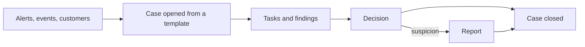

import { AGENT, PageMeta, LifecycleStepper, ExampleNote, Important, PreviewNotice, Screenshot } from "/snippets/components.jsx";

<PageMeta tracks={["operations"]} minutes={5} availability="ga" />

<LifecycleStepper current="investigate" />

A case is your record of one investigation. It gathers the alerts, transfers, customers and screening results you examine, the tasks you work through, and the decision you reach. When an examiner asks what you did about a customer, the case is the answer.

## Why it matters

An alert tells you why something was raised. It does not tell you what you did next. A case holds that story in one place: the work plan, the findings, the evidence and the decision, with who did what and when.

Cases also keep your team consistent. A case template gives every investigation of the same kind the same checklist. Required tasks and second-person reviews are built in, so nothing is skipped under time pressure.

## How it works

<PreviewNotice feature="Each of these case features (opening a case from an alert, task checklists from a case template, proposing and recording a suspicion decision, and examiner export with its audit log entry)" />

You open a case from an alert. You can also open one from a customer profile or an event, even when no alert exists. Your cases are listed under **Cases**, with the statuses **Escalated**, **In Review**, **Resolved** and **On hold**. The case links these items. It does not copy them: the alert keeps its explanation, and the screening match keeps its decision.

### Case templates and tasks

A case template is the plan for one kind of investigation. It lists the tasks, which ones are mandatory, the order they depend on, and which ones a second person must review. Opening a case from a template creates that checklist. You can add your own tasks for work the template did not foresee.

Tasks are the work. The checklist is the default view. You can also see the case as a board by stage or by task status, or as a graph of everything linked to it.

### Findings and evidence

A finding is a conclusion you record, such as the pattern you see and why. Evidence is what supports it: a document, a call report, a linked transfer. Each piece of evidence keeps its source and the date you collected it. Files you attach cannot be changed afterwards.

### Deciding suspicion

The case ends with a decision. For an anti-money laundering (AML) case, you decide whether suspicion is established, and whether to file a report. Other outcomes cover false positives, activity that is real but explained, duplicates and cases without enough information.

Your organization can require two people for a decision: one proposes, a different person records it. The decision is saved with a snapshot of the facts it relied on.

<Important>
  Deciding suspicion and filing a report are always human decisions. Report details stay restricted to people allowed to see them, so the customer is not alerted that they were reported.
</Important>

### Escalation

When you need a senior decision, you escalate the case to a person or a team, with a reason. The case waits for them to accept it. Escalating a screening match to a senior reviewer works the same way.

### Closing

A case closes only when its required work is done. Mandatory tasks must be finished, screening matches decided, and any required report submitted. You can reopen a closed case with a reason; earlier decisions stay on record.

### Examiner export

When an examiner or auditor asks for a case, you export it. The export holds the decisions, snapshots, comments and evidence you are allowed to see. Each export is recorded in the audit log.

### The assistant can prepare the case (Preview)

{AGENT}, the AI assistant, can prepare a case for you. It gathers linked alerts, screening results and profile facts, proposes tasks and drafts a summary with citations. You review and edit everything. {AGENT} cannot record a decision or submit a report. See [Human in the loop](/ai-assistant/human-in-the-loop).

## What you get

- One record per investigation, linked to every alert, transfer and customer involved.
- A checklist from your case template, with required tasks and second-person reviews (preview).
- A recorded decision with the facts it relied on (preview).
- An export ready for an examiner (preview).

## Where it appears in the 360° view

Each customer profile lists the cases the customer is part of, with their stage and outcome. From the profile you can open a case or add the customer to one. From a case, each linked customer opens their profile.

## See it in the remittance example

<ExampleNote />

The alert on Moussa Ndiaye, `alt_smp_0001`, becomes case `cas_smp_0001`. The case uses the _AML suspicion review_ template. {AGENT} gathers the five transfers, the cleared screening match on Moussa and the facts on his profile. It proposes tasks and drafts a summary. The analyst checks each citation, edits the summary and works the tasks.

<Screenshot name="cases-workspace-moussa-checklist" alt="Case cas_smp_0001 on Moussa Ndiaye in the checklist view: the linked alert and five transfers, the proposed tasks, and the draft summary waiting for the analyst's review." />

The money laundering reporting officer (MLRO) then decides there is suspicion. A suspicious transaction report (STR) is filed, and the case closes with the report reference.

Chapter 9, [The assistant prepares the case](/tutorial/assistant-prepares-the-case), and chapter 10, [Decide and report](/tutorial/decide-and-report), walk through this case.

## In this section

Planned how-to guides for this stage:

- What a case is (vs an alert)
- Case templates and tasks (preview)
- Findings and evidence
- Deciding suspicion (preview)
- Escalation
- Closing a case
- Examiner export (preview)

## Related

- [Alerts](/guides/alerts/overview)
- [Reporting](/guides/reporting/overview)
- [The assistant prepares the case (tutorial chapter 9)](/tutorial/assistant-prepares-the-case)
- [Human in the loop](/ai-assistant/human-in-the-loop)
- [The 360° customer view](/get-started/360-view)
