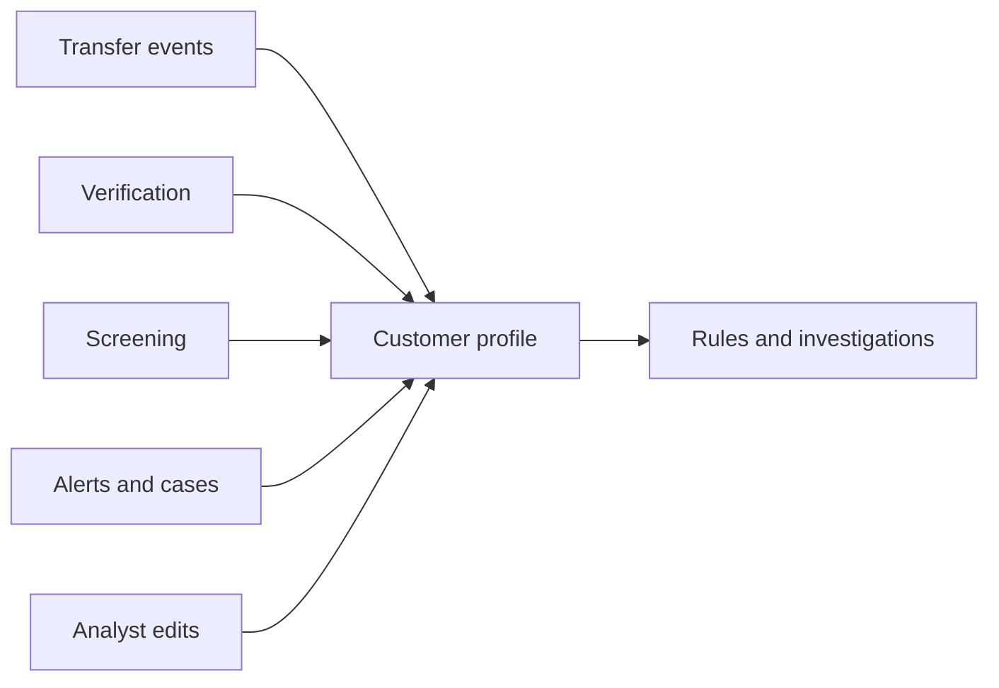

import { PageMeta, LifecycleStepper, ExampleNote, Screenshot } from "/snippets/components.jsx";

<PageMeta tracks={["operations", "configure"]} minutes={6} availability="ga" />

<LifecycleStepper current="investigate" />

The entity profile is one page per customer, partner or counterparty. It brings together everything Skaletek knows about them: identity, verification, transfers, screening, alerts, labels and relationships. You open it from any alert, case or event where the customer appears.

## Why it matters

A single transfer rarely tells the whole story. The pattern shows only when you see the customer's history, who they deal with, and what checks they have passed. Without one view, an analyst gathers this from several screens and can still miss a link.

The profile also explains itself. Each value shows where it came from and when it changed. When an examiner asks why you believed an address was current, you can show the source.

## How it works

### One profile per customer, across every event

Each event names the people and organizations involved, in roles such as sender and recipient. Skaletek links each of them to a profile. When a later event names the same person, it lands on the same profile, so history builds up over time.

You decide how a customer is recognised. In each event template, you choose the identifiers for each role, such as an identity document number, and their order of priority. Two events that share one of these identifiers belong to the same customer. This works across templates too: the same person can appear as a sender in one kind of event and a recipient in another.

When Skaletek finds signs that two profiles might be the same customer, it proposes a merge for a person to review. It never merges profiles on its own. Merges and splits can be undone, and each one is recorded.

### Profile history and lineage

Customers change address, correct a spelling or get a new document. The profile shows the current value of each field, and keeps the earlier ones. Open the history of a field to see each value it has had, where it came from, and when. A value verified through know your customer (KYC) checks outranks a value typed on a later transfer.

The profile also keeps a record of the merges, splits and pending merge proposals that involve it.

### Labels

Labels are tags such as "high risk" or "politically exposed person". A rule, a screening decision or an analyst can add them. Rules can check labels, so a label added today can change how tomorrow's transfers are handled. To add one yourself, use **Add label** in the profile header. The profile keeps active labels and also expired and removed ones, with who added them and why.

### Relationships graph

The **Explore** tab draws a network graph of who the customer deals with: senders, recipients, agents, shared accounts and wallets. Ownership links from know your business (KYB) checks appear as their own kind of link. Expand any node to follow the money further.

### Entities list and saved views

**Data** › **Entities** ranks your profiles in four panels: **Highest Velocity**, **Sum of Transactions**, **Most risk** and **Most Flags**. Each row shows the name, status, the panel's measure and a risk score. Filter by direction, status and country, and choose the period. Saved views let you keep a filtered list and share it with your team.

## What you get

- One page per customer in three tabs: **Details** for the profile fields and appearances, **Alerts** for the alerts raised on them, and **Explore** for their network. **Screen entity** screens them on demand.
- A source and a history for every profile value.
- Merge proposals for likely duplicates, decided by a person.
- A relationships graph you can explore from the profile.
- A searchable list of all profiles with saved views.

<Screenshot name="entities-profile-overview" alt="Moussa Ndiaye's entity page on the Details tab: his summary on the left and the Appearances table listing the five transfers he received, TT-REMIT-0001 to TT-REMIT-0005." src="/images/screenshots/entities-detail-moussa.light.en.png" />

## Where it appears in the 360° view

This is the 360° view. Every other stage adds to it: onboarding adds verification, screening adds results and decisions, monitoring adds events and alerts, and cases add investigation history. See [The 360° view](/get-started/360-view) for the full picture.

## See it in the remittance example

<ExampleNote />

Moussa Ndiaye receives five transfers over six days, from Aminata Sow, Fatou Ba and Cheikh Tall. Each transfer names him with the same identifiers, so all five land on his profile. His profile shows the three senders, the payout agent Point Marché Tilène, his timeline, his labels and the cleared screening match. Open the history of his address to see where each value came from.

Follow it in [See the whole picture](/tutorial/see-the-whole-picture).

## In this section

- The entity profile
- How the platform recognises the same customer across events
- Profile history and lineage
- Labels
- Relationships graph
- Entities list and saved views

## Related

- [The 360° view](/get-started/360-view)
- [Onboarding overview](/guides/onboarding/overview)
- [Alerts overview](/guides/alerts/overview)
- [Monitoring overview](/guides/monitoring/overview)
- [See the whole picture](/tutorial/see-the-whole-picture)
