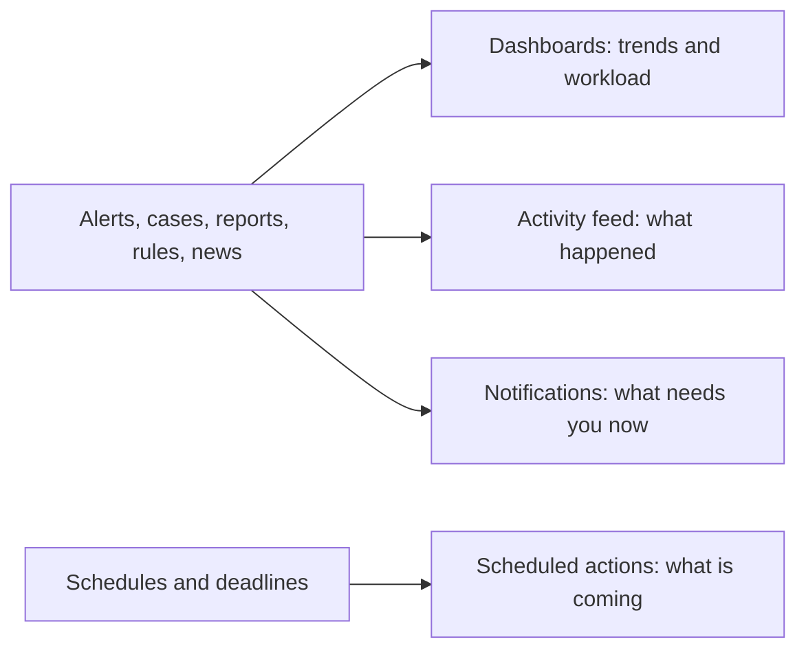

import { PageMeta, LifecycleStepper, ExampleNote, Screenshot } from "/snippets/components.jsx";

<PageMeta tracks={["operations"]} minutes={4} availability="ga" />

<LifecycleStepper />

Dashboards and activity show you what is happening across every stage at once. Dashboards chart volumes, workload and trends. The activity feed, scheduled actions and notifications tell you what changed, what is coming and what needs you now.

## Why it matters

A team lead needs to know, every morning, where the work is piling up and which deadlines are close. An analyst needs to catch the alert assigned to them the moment it arrives. Without one place for this, people check five screens and still miss something.

## How it works

Activity across Skaletek feeds four views. Each answers a different question.

### Dashboards

**Dashboard** is your home screen. Its tiles show **Events Today**, **Open Alerts**, **Rule Fired** and **Entities at Risk**, each with a small chart. Below them, panels list **Open Alerts**, **Recent Events** and **High Risk Entities**. Pick the period with the chips under the heading, from **Today** to **Last 90 days**. Expand a chart to see it larger, or select **See all** on a panel to open the matching list.

Further dashboards go deeper:

| Dashboard | What it shows |
| --- | --- |
| Alerts | Open alerts by severity, average time to acknowledge and resolve, overdue alerts, workload per person. |
| Cases | Open cases by type and stage, and missed decision or filing deadlines. |
| Entities | Customer leaderboards for a period, country or unit. |
| Rules | How often each rule fires, how often its alerts are dismissed, and shadow results next to live ones (shadow mode is in preview). |
| Events | Event volume by template and the share of events rejected. |

Every dashboard shows only what you are allowed to see.

### Home activity feed

The activity feed is a running log of what happened that matters to you: alerts assigned, rules activated, reports due or submitted, news from your authorities. It marks what is new since your last visit. Use it to catch up after time away.

### Scheduled actions

The **Scheduled action center**, behind the calendar icon in the top bar, lists everything that runs on a timetable: scheduled rules, periodic reports and obligation deadlines. Three views show them: **Upcoming**, **Calendar** and **History**. From an entry you can run it now, pause or resume it, or open it to edit.

### Notifications

Notifications tell you what needs you now: an alert assigned to you, an SLA (service-level agreement) about to be missed, a change package ready to review, a deadline approaching. You mark them as read once handled. Under **Settings** › **General Settings** › **Personal** › **Notifications**, you choose how you receive them: **Email** or **In-app**.

The notification center is for catching things now. The activity feed is for reviewing what happened.

<Screenshot name="dashboard-overview-teranga" alt="Teranga Transfer's Dashboard: one high-severity alert open, Moussa Ndiaye at the top of the customer leaderboard, and the activity feed showing the report filed with CENTIF-GN." />

## What you get

- One home screen with volumes, workload and the customers to watch.
- Dashboards per area, each opening the list behind a chart.
- A feed of what happened and a calendar of what is coming.
- Notifications you choose, where you want them.

## Where it appears in the 360° view

Each row of a customer leaderboard opens that customer's profile. The leaderboard shows the same at-a-glance columns as the customer list, such as risk, labels and open alerts.

## See it in the remittance example

<ExampleNote />

At the end of the story, Teranga Transfer's **Dashboard** shows the high-severity alert raised on Moussa Ndiaye. Moussa leads the leaderboard by amount: he received 24,000,000 XOF in six days. The activity feed shows the case on Moussa closing and the suspicious transaction report filed with CENTIF-GN.

Chapter 12 of the tutorial, [Prove it](/tutorial/prove-it), shows the dashboard alongside the traceability matrix and the examiner export (both in preview).

## In this section

Planned how-to guides for this stage:

- Dashboards
- Home activity feed
- Scheduled actions
- Notifications

## Related

- [Alerts](/guides/alerts/overview)
- [Cases](/guides/cases/overview)
- [Reporting](/guides/reporting/overview)
- [Prove it (tutorial chapter 12)](/tutorial/prove-it)
- [The 360° customer view](/get-started/360-view)
