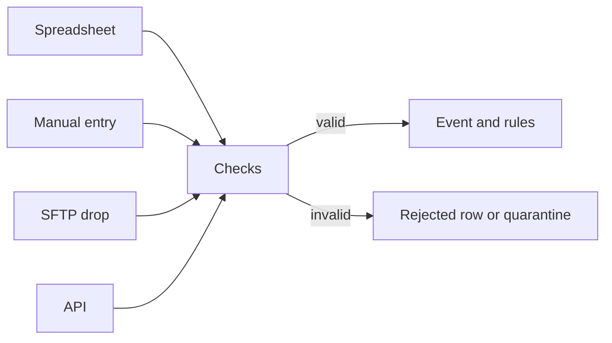

import { PageMeta, LifecycleStepper, ExampleNote, PreviewNotice, Screenshot } from "/snippets/components.jsx";

<PageMeta tracks={["operations", "configure", "build"]} minutes={6} availability="ga" />

<LifecycleStepper current="monitor" />

<PreviewNotice feature="No-code submission (spreadsheet upload, manual entry and SFTP drops)" />

Skaletek monitors what you send it. Each transfer, withdrawal or payment you send becomes an event, checked against its template and your rules. You can send events by uploading a spreadsheet, typing them into a form, dropping files on a secure folder, or connecting your systems through the API.

## Why it matters

You do not need a developer to start. Most teams already have their data in spreadsheets or exports from a core system. You can see alerts on your own data within minutes, then automate the same flow later without starting again.

Whichever way you choose, every event goes through the same checks and the same rules. An event uploaded from a spreadsheet is treated exactly like one sent through the API.

## How it works

### Ways to send data

| Situation | Method |
| --- | --- |
| A few events: a missing transfer, a correction, a test of a rule | Manual entry: a form where you type each event |
| A batch from a spreadsheet or a one-off export | Spreadsheet upload: you upload a file of events |
| The same export every day or week from a core system | SFTP drop: a folder on a secure file transfer (SFTP) server that Skaletek reads |
| Continuous integration with your systems | API: your systems send each event as it happens, through the application programming interface (API) |

### Sample files

Each template has its own spreadsheet layout, in English or French. Download the Excel or comma-separated values (CSV) sample from the upload screen or the template page. It has one column per field, notes on each header, dropdowns for allowed values and an instructions sheet.

### Mapping your columns

Your own export rarely has the same headers as the sample. When you upload a file, Skaletek matches your columns to the template's fields. It marks each match as certain or likely, and you confirm the likely ones. You can map the rest by hand, set the same value for every row, or translate values, such as "FCFA" to XOF, the code for the West African CFA franc. Save the mapping to reuse it next time.

### Rejected rows

Before anything is imported, Skaletek checks the whole file and previews the first rows. A row with a problem, such as an unreadable date, is rejected with a reason; it never becomes an event. You then choose to import the valid rows or to cancel and fix the file.

Download the error file: it holds the rejected rows with an Errors column. Fix them and upload the same file again. Events sent through the API that fail the checks are held in quarantine instead, on the **Quarantined** tab of **Data** › **Transactions & Events**. There your developers can correct them and use **Retry all retriable**, or **Dismiss selected**.

### Imports are final

<Warning>
  An imported event cannot be removed. It may already have raised alerts, counted in other rules' windows or updated customer profiles. The confirmation step says so and asks you to confirm the number of rows.
</Warning>

If you import something by mistake, you correct what surrounds it. Send a correcting event, then move the wrong one to a closed status with a reason. Dismiss alerts raised on wrong data, and fix or merge customer profiles. A correction option on the import result gathers all of this in one place.

<Accordion title="For developers" icon="code">
  The API sends events one at a time or in batches, with the same checks. Start with the [developer quickstart](/developers/quickstart), then see [errors](/developers/errors) and the [API reference](/api-reference/introduction).
</Accordion>

## What you get

- Four ways to send events, all with the same checks and rules.
- Sample files generated from your template, in English or French.
- Saved column mappings, reused by later uploads and SFTP drops.
- An outcome for every row: imported, rejected or skipped, with a reason. No row is silently dropped.
- A result file to reconcile each imported row with your source system.

<Screenshot name="ingestion-upload-columns-mapped" alt="Column mapping step of a spreadsheet upload, with the file's headers matched to the Remittance transfer template and one likely match waiting for confirmation" />

## Where it appears in the 360° view

Every imported event appears in the **Appearances** table on the **Details** tab of each customer it names, with its source. The people and organizations in it are linked to their profiles, or new profiles are created. See [The 360° view](/get-started/360-view).

## See it in the remittance example

<ExampleNote />

Teranga Transfer has no developer at first. The analyst downloads the remittance starter pack's Excel sample, which already holds the five transfers to Moussa Ndiaye, `SAMPLE-REMIT-0001` to `SAMPLE-REMIT-0005`. Uploading it unchanged offers to load the pack's sample data instead, which loads the transfers as sample data. The transfers arrive, and Moussa's profile starts to fill.

Follow it in [Send transfers](/tutorial/send-transfers). That chapter also shows the same transfers sent through the API.

## In this section

- Ways to send data: spreadsheet, manual form, SFTP and API
- Download a sample file
- Upload a spreadsheet
- Map your columns
- Fix rejected rows
- Correct a mistake after import
- Set up an SFTP drop

## Related

- [Monitoring overview](/guides/monitoring/overview)
- [Send transfers](/tutorial/send-transfers)
- [Developer quickstart](/developers/quickstart)
- [Errors](/developers/errors)
- [Glossary](/glossary)
