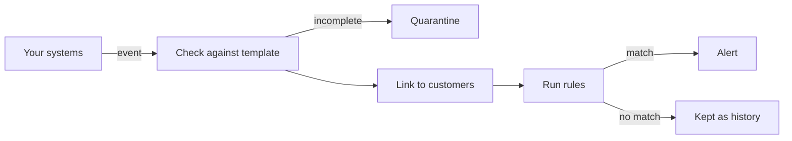

import { PageMeta, LifecycleStepper, ExampleNote, PreviewNotice, Screenshot } from "/snippets/components.jsx";

<PageMeta tracks={["configure", "operations"]} minutes={7} availability="ga" />

<LifecycleStepper current="monitor" />

Monitoring watches what your customers do and tells you when something needs a look. Each time something happens, such as a transfer, your systems send Skaletek an event. Skaletek checks it, links it to the customers involved, runs your rules, and raises an alert with the evidence when a rule matches.

## Why it matters

Suspicious activity rarely shows in one transaction. It shows in a pattern: many transfers just under a limit, several senders paying one person, an agent paying out more cash than usual. Monitoring finds these patterns across your customers' history, so your team does not have to.

You stay in control of what counts as suspicious. You write the rules and set the thresholds. Every alert says which rule matched and why, in terms you can explain to a regulator.

## How it works

### From event to alert

1. Something happens. A customer sends money. Your system, a spreadsheet or a person sends Skaletek an event describing it: who was involved, how much, when and where.
2. Skaletek checks the event is complete. Each kind of event has a template that says what it must contain. An event sent through the API that is missing something is held in quarantine so it can be corrected and sent again. Nothing is silently lost.
3. Skaletek works out who is involved. The people and organizations in the event are linked to their customer profiles. This is how Skaletek knows that today's recipient received four other transfers this week.
4. Your rules run. A rule can look at the event alone or at the customer's history.
5. An alert is raised. When a rule matches, the alert carries the values, the time window and the transfers behind it. A rule can also change the event's status or add a label to the customer.

### Events and templates

A template describes one kind of event. It names the roles involved, such as sender, recipient and payout agent, and the details each one carries. It also says which identifiers recognise each customer across events.

You find your templates under **Settings** › **Configuration** › **Templates**, and the rules on each one under **Settings** › **Configuration** › **Rules**. Templates are versioned. A template starts as a draft. Once you activate it, it accepts events and can no longer be edited; a change creates a new version.

### Starter packs

A starter pack installs a ready-made template, rules, reports and sample data for one kind of business, such as remittance. You can adapt everything it installs. Starter packs are in preview.

### Designing a template

You can also design a template from scratch, or adapt one from a pack. Choose the roles, the fields each role carries and the identifiers that recognise each customer. Then activate the template to start receiving events.

### Rules

A rule is a condition plus what to do when it is true. You build rules in a visual editor, with fields picked from the template. Start one with **Create rule** under **Settings** › **Configuration** › **Rules**.

### Patterns library

<PreviewNotice feature="Each of the next four features (the patterns library, a dedicated screen for parameters, testing rules on past data and shadow mode)" />

Many useful checks look across history: how many transfers a recipient received in seven days, or from how many different senders. The patterns library holds these ready-made building blocks. You insert a pattern into a rule and fill in its settings; you do not write the logic yourself.

### Parameters: thresholds you own

A threshold you can set, called a parameter, is a value your rules share, such as a declaration threshold. It belongs to the template, not to each rule. Change it once, and every rule that uses it follows. Each change creates a new template version and is recorded with who made it.

### Testing rules on past data

Before a rule affects your team, test it on past data, also called a simulation. Pick a date range and run the rule against the events you already have. Skaletek shows how often it would have matched and the alerts it would have raised. Nothing is changed and no alert is created.

### Shadow mode

A new rule starts in shadow mode. It runs on real events and records its results, but raises no alerts and takes no actions. Watch it for a while, adjust it, then switch it to live.

### When rules run

| When | What it is for |
| --- | --- |
| Real time | Decisions that must happen before the transaction completes, such as holding a payment. Your system waits for the answer. |
| Near real time | Everything else, and the default. The transaction is not held up, and the alert follows within seconds. |
| **Scheduled** | Patterns across a whole day or month, run at set times across a group of customers or events. |

<Accordion title="For developers" icon="code">
  Real-time rules can affect the answer only when your system sends events one at a time through the API. To send your first event and see a rule match, follow the [developer quickstart](/developers/quickstart).
</Accordion>

## What you get

- Templates that describe your events and recognise your customers across them.
- Rules built from ready-made patterns, with thresholds you own (patterns library and parameters screen in preview).
- Tests on past data and shadow mode (preview), so you see a rule's effect before it reaches your team.
- Alerts that state which rule matched, on which values, in which time window.
- A quarantine for incomplete events, so nothing is lost.

<Screenshot name="monitoring-rule-test-results" alt="Results of testing Rule 1 on past transfers, showing how many times it would have matched and the alert it would have raised on Moussa Ndiaye" />

## Where it appears in the 360° view

Every event appears in the **Appearances** table on the **Details** tab of each customer it names. Alerts appear on the profile's **Alerts** tab, and labels that rules add appear on the profile. See [The 360° view](/get-started/360-view).

## See it in the remittance example

<ExampleNote />

Teranga Transfer installs the remittance starter pack. Its _Remittance transfer_ template has a sender, a recipient, an optional payout agent and the transfer details. The pack sets one parameter, the _Declaration threshold_, at 5,000,000 West African CFA francs (XOF). See [Describe your transfers](/tutorial/describe-your-transfers).

Rule 1 looks for transfers just below the threshold: at least three transfers to the same recipient within seven days, from at least two senders, each between 90% and 100% of the threshold. Because the rule reads the parameter, its band moves when the threshold does.

Over six days, Moussa Ndiaye receives five transfers between 4,600,000 and 4,950,000 XOF from three senders. The third transfer, `SAMPLE-REMIT-0003` on day 3, completes the pattern. Rule 1 raises one alert, and raises no more for Moussa for seven days. See [An alert, explained](/tutorial/an-alert-explained).

## In this section

- Events and templates
- Starter packs
- Designing a template
- Rules
- Patterns library (preview)
- Parameters: thresholds you own (preview)
- Testing rules on past data (preview)
- Shadow mode (preview)
- Scheduled rules

## Related

- [Getting data in overview](/guides/getting-data-in/overview)
- [Alerts overview](/guides/alerts/overview)
- [Describe your transfers](/tutorial/describe-your-transfers)
- [An alert, explained](/tutorial/an-alert-explained)
- [When the rules change](/tutorial/when-the-rules-change)
