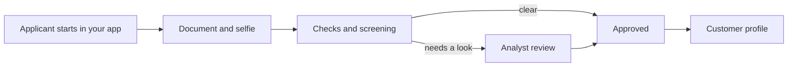

import { PageMeta, LifecycleStepper, ExampleNote, Screenshot } from "/snippets/components.jsx";

<PageMeta tracks={["operations", "build"]} minutes={6} availability="ga" />

<LifecycleStepper current="onboard" />

Onboarding is where you find out who your customers and partners are before you do business with them. Skaletek verifies people with know your customer (KYC) checks and organizations with know your business (KYB) checks. Each verified person or organization becomes a customer profile that screening, monitoring and investigations all build on.

## Why it matters

Every later decision depends on knowing who you are dealing with. An alert on a transfer means little if you are not sure the sender is who they claim to be. A partner agent is only as trustworthy as the people who own and control it.

Regulators expect you to show this work. With onboarding inside the same platform as monitoring, the evidence sits on the customer profile. You do not have to piece it together from another tool when an examiner asks.

## How it works

The person being verified goes through a guided flow. Your compliance team reviews what the flow collected and decides.

### Verifying people (KYC)

The applicant photographs an identity document and takes a selfie. Skaletek reads the document, checks that it looks genuine, and checks that the selfie is a live person who matches the document photo. The applicant confirms the details read from the document, and can correct them. Both the value read and the value the applicant confirmed are kept.

The person is then screened against sanctions and politically exposed person (PEP) lists. Clear results can be approved automatically, depending on how you set up the flow. Anything unusual goes to review on the **Individual** tab of **Verifications**, where an analyst approves, rejects, or asks for another document, always with a reason.

### Verifying organizations (KYB)

A KYB file gathers what you need to accept a company: registry details, documents, and who owns and controls it. The company's representative fills in forms and uploads documents. Each owner, director or signatory completes their own identity check; nobody completes it for someone else.

The file shows its progress as a list of blockers, such as a missing document or an owner who has not finished. KYB files are listed on the **Company** tab of **Verifications**. When the file is complete, an analyst reviews it and decides: **Approve**, **Decline** or **Restrict**. Approving freezes that version of the file as evidence.

### Beneficial owners and control

The **Ownership** tab of the KYB file draws an ownership graph: the company, the people and companies that own it, and the percentages. From the graph, Skaletek works out the beneficial owners for anti-money laundering (AML) purposes. It also shows a separate view of ownership for sanctions purposes. Control by other means, such as a director with no shares, is recorded too.

You cannot mark an organization as verified while anyone in its ownership graph is still unscreened.

### Re-verification

A verification does not last forever. Skaletek tracks identity document expiry dates and flags a profile before its document expires. KYB files are refreshed on a schedule you set, or when something changes, such as a new director. A refresh opens a new version of the file; the earlier version stays as it was.

### Embedding the flow in your app

Your customers complete verification inside your own app or website. The flow currently shows the Skaletek name and logo; it cannot yet carry your own branding. It works on a phone, lets the applicant switch device, and resumes where they left off if they are interrupted.

<Accordion title="For developers" icon="code">
  Your app starts a verification session through the API and opens the flow with the session it receives. Results reach you through webhooks. Start with the [developer quickstart](/developers/quickstart) and the [API reference](/api-reference/introduction).
</Accordion>

## What you get

- A customer profile for each verified person and organization, with the verified values marked as such.
- A review queue that shows what needs a human decision and why.
- An ownership graph for each organization, with beneficial owners worked out for you.
- A frozen evidence record of every decision: who decided, when, and on what.
- Reminders when a document is about to expire or a KYB file is due for refresh (preview).

<Screenshot name="onboarding-kyb-ownership-graph" alt="KYB ownership graph of a partner agent, showing the company, its beneficial owner and the ownership percentage, so you can check who stands behind it" />

## Where it appears in the 360° view

Onboarding feeds the customer profile directly. A person's verification status, documents and each verification session open from the **Individual** tab of **Verifications**. An organization's ownership graph, open tasks and version history open from the **Company** tab.

The verification status also appears on the customer's rows under **Data** › **Entities**, as a chip such as "KYC Pending", with a marker when a refresh is due. See [The 360° view](/get-started/360-view) for how it fits with the rest.

## See it in the remittance example

<ExampleNote />

Teranga Transfer onboards both its senders and its partner agents. Aminata Sow verifies her identity in Teranga's app with her passport `SAMPLE-P-0001` and a selfie. The check passes and her profile is created. Follow her in [Onboard a sender](/tutorial/onboard-a-sender).

Point Marché Tilène, the payout agent in Dakar, goes through KYB. Its trade register number (RCCM) `SAMPLE-RCCM-0005` and national business identification number (NINEA) `SAMPLE-NINEA-0005` identify it. The ownership graph shows its beneficial owner, Ibrahima Fall. See it in [Onboard a partner agent](/tutorial/onboard-a-partner-agent).

## In this section

- [How identity verification works](/guides/onboarding/verifying-people)
- [Review an identity verification](/guides/onboarding/reviewing-a-verification)
- [Verification workflows](/guides/onboarding/verification-workflows)
- [Re-verification and step-up](/guides/onboarding/re-verification-and-step-up)
- Verifying organizations (KYB)
- Beneficial owners and control

## Related

- [Screening overview](/guides/screening/overview)
- [Customer 360° overview](/guides/customer-360/overview)
- [Onboard a sender](/tutorial/onboard-a-sender)
- [Onboard a partner agent](/tutorial/onboard-a-partner-agent)
- [Glossary](/glossary)
