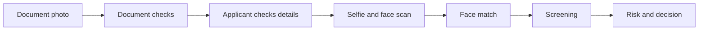

import { PageMeta, LifecycleStepper, ExampleNote } from "/snippets/components.jsx";

<PageMeta tracks={["configure"]} minutes={5} availability="ga" />

<LifecycleStepper current="onboard" />

A verification workflow is the list of checks an identity verification runs. Identity verification is the electronic part of know your customer (KYC) checks. It decides what the applicant is asked to do and what Skaletek checks before it decides. Every verification session follows exactly one workflow.

## The order of checks is fixed

All workflows draw from the same set of checks, in the same order. A workflow switches checks on or off; it never changes their order. This keeps every session predictable for the applicant and comparable for your reviewers.

1. **Document photo.** The applicant photographs their identity document.
2. **Document checks.** Skaletek checks the photo quality, recognizes the document type and reads the details.
3. **Applicant checks details.** The applicant confirms or corrects the details read from the document.
4. **Selfie and face scan.** The applicant takes a selfie and scans their face, to show a live person is present.
5. **Face match.** Skaletek compares the face with the photo on the document.
6. **Screening.** Skaletek screens the person against sanctions and politically exposed person (PEP) lists.
7. **Risk and decision.** Skaletek weighs all results and approves, rejects or sends the session to review.

## Available workflows

Skaletek provides these ready-made workflows.

| Workflow | What it runs | Use it for |
| --- | --- | --- |
| Standard KYC | All seven steps above. This is the default. | Most new customers |
| Full KYC | Standard KYC, plus reading the machine-readable zone and chip of the document where it has one, checks for signs of tampering, and a cross-check of details against reference data | Higher-risk customers or markets that ask for stronger document checks |
| Full KYC with deduplication | Full KYC, plus a check that the same face has not already been verified under another identity | Preventing one person from opening several accounts |
| NFC-first KYC | Reads the document's chip by near-field communication (NFC) first, where the document and phone support it | Customers with chip passports or chip ID cards |
| Document upload only | The document steps, screening and decision, with no selfie or face scan | Cases where you verify the document but not the person's face |
| Document refresh | A new photo of an identity document for a customer you already verified | Replacing an expired document. See [Re-verification and step-up](/guides/onboarding/re-verification-and-step-up). |
| Liveness only | The selfie and face scan only | Checking that a live person is present |
| Liveness step-up | Selfie, face scan and a face match against the customer's verified face, then a decision | Asking a verified customer to prove it is them again |
| API only | Document and selfie images sent by your systems, with no applicant on screen and no details check by the applicant | Verifying images you already collected in your own app |

## How to choose

- Start with Standard KYC. It covers the checks most regulators expect for a new customer.
- Move to Full KYC or Full KYC with deduplication when your risk assessment calls for stronger document checks or you see repeat sign-ups.
- Use Liveness step-up for customers you already verified, before a sensitive action.
- Use API only when your own app collects the images and you cannot send the customer to the verification flow.

Your developers name the workflow when they start each session, so you can use different workflows for different customers or products.

## Manage workflows

Workflows live under **Settings** › **Configuration** › **Workflows**. You need the **Manage Identity Verification Workflows** permission to create or change them.

The list shows each workflow's NAME, KEY, STEPS INCLUDED, STATUS, SESSIONS and LAST MODIFIED. A workflow is **Draft**, **Active** or **Deprecated**.

To create a workflow, click **Create workflow**. In **Select a template**, start from one of the ready-made workflows or choose **Create from scratch**. The builder groups the checks into **Starting step**, **Intake**, **Document**, **Biometrics**, **Background checks**, **Outcome** and **Rule**. Use **Preview flow** to see what the applicant will see, **Save draft** to keep your changes, and **Publish** to make the workflow available for new sessions.

<Accordion title="For developers" icon="code">
  Each workflow has a key, shown in the KEY column. Pass it when you create a session. If you pass none, the session uses Standard KYC, or API only for API-only verifications. See [Workflows](/developers/ekyc/workflows) for the keys of the ready-made workflows.
</Accordion>

## See it in the remittance example

<ExampleNote />

Teranga Transfer verifies new senders, such as Aminata Sow, with Standard KYC. Before an unusually large transfer from an existing sender, such as Fatou Ba, it uses Liveness step-up.

## Related

- [How identity verification works](/guides/onboarding/verifying-people)
- [Re-verification and step-up](/guides/onboarding/re-verification-and-step-up)
- [Review an identity verification](/guides/onboarding/reviewing-a-verification)
- [Onboarding overview](/guides/onboarding/overview)
