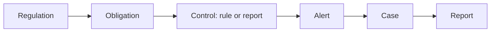

import { AGENT, PageMeta, LifecycleStepper, ExampleNote, PreviewNotice, Screenshot } from "/snippets/components.jsx";

<PageMeta tracks={["operations", "configure"]} minutes={5} availability="preview" />

<PreviewNotice feature="Regulatory compliance" />

<LifecycleStepper current="comply" />

Regulatory compliance connects the rules you must follow to the controls that follow them. Skaletek keeps a catalog of regulations and the obligations they contain, tells you when they change, and proposes the updates your rules and reports need. A traceability matrix shows an examiner, line by line, how each obligation is met.

## Why it matters

Regulations change, and a monitoring rule written last year may no longer match the text. Without a link between the two, you find out during an inspection. With it, a change reaches the people who own the affected rules, and you can show which control answers which requirement.

## How it works

Each regulation breaks down into obligations: discrete requirements you can test, such as "report suspicious transactions" or "declare cash transactions above a threshold". You link an obligation to the controls that meet it: a rule, an event template, a reporting template or a list. From there, every alert and report those controls produce carries the link.

Linking is optional. A fraud rule or an internal rule works the same with or without an obligation.

The area is planned in five parts:

| Part | What it gives you |
| --- | --- |
| Catalog | The regulations and obligations published for your authorities. Each obligation lists the rules, templates and reports mapped to it, or shows a gap when there are none. |
| Subscriptions | The authorities, regulations or obligations you follow. Setup subscribes you to the ones that apply to your business; you can add or remove others, for the whole organization or one unit. |
| News | Updates from your authorities, such as consultations and new texts, marked info, watch or actionable. |
| Change packages | When a regulation you follow changes, what changed, which of your rules and reports it affects, and proposed updates for you to review. |
| Traceability matrix | A table from regulation to article, obligation, control, report and owner. You can filter it and export it for an examination. |

A change package never changes a live rule on its own. Proposed rule updates arrive in shadow mode, so you can test them on past data first. You accept, dismiss or ask for a revision, and an administrator activates the result.

Obligations with deadlines, such as a monthly return, also appear in your scheduled actions, with reminders before they are due.

{AGENT}, the AI assistant, can explain a regulation or obligation with citations, summarize news and prepare the drafts in a change package. You review and approve each one. See [Human in the loop](/ai-assistant/human-in-the-loop).

## What you get

- A catalog of the regulations that apply to you, broken into obligations.
- News and change packages when a regulation you follow changes.
- Proposed updates to your rules and reports, tested before they go live.
- A traceability matrix you can export for an examiner, with gaps shown.

## Where it appears in the 360° view

When a rule is linked to an obligation, the alerts it raises carry that link. On a customer profile, you can see which obligation an alert relates to, and follow it to the regulation.

## See it in the remittance example

<ExampleNote />

During setup, Teranga Transfer subscribes to the regulations that apply to a money transfer company in Senegal. Its declaration threshold parameter, 5,000,000 XOF, is linked to the obligation it implements.

In chapter 11, a _fictional_ new instruction lowers the declaration threshold to 4,000,000 XOF. The news appears in the regulatory news. The obligation is updated, and a change package proposes the new parameter value. Testing it on past transfers shows the impact, and an administrator activates it.

<Screenshot name="regulatory-change-package-threshold" alt="A change package for the fictional instruction: the obligation change, the affected declaration threshold, and the proposed new value of 4,000,000 XOF waiting for review." />

In chapter 12, the traceability matrix shows the chain from the regulation to Rule 1, to the alert on Moussa Ndiaye, to the report filed with CENTIF-GN.

Read [When the rules change](/tutorial/when-the-rules-change) and [Prove it](/tutorial/prove-it) to follow both chapters.

## In this section

Planned how-to guides for this stage:

- From regulation to control
- The regulatory catalog
- Obligations
- Subscriptions
- Regulatory news
- Change packages
- Traceability matrix

## Related

- [Monitoring](/guides/monitoring/overview)
- [Reporting](/guides/reporting/overview)
- [When the rules change (tutorial chapter 11)](/tutorial/when-the-rules-change)
- [Prove it (tutorial chapter 12)](/tutorial/prove-it)
- [Human in the loop](/ai-assistant/human-in-the-loop)
