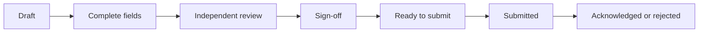

import { PageMeta, LifecycleStepper, ExampleNote, Important, Screenshot } from "/snippets/components.jsx";

<PageMeta tracks={["operations", "configure"]} minutes={5} availability="ga" />

<LifecycleStepper current="report" />

Reporting turns what you found into what you must file. Skaletek prepares each report from your cases, events and schedules, routes it through review and sign-off, and records when and how it was filed. The same tools serve regulatory filings and your own internal reports.

## Why it matters

Filings have legal deadlines, prescribed formats and strict confidentiality. A missed deadline or a report re-typed from scratch is a compliance risk. When each report is filled from the data you already hold, and tracked to the date it was filed, you spend your time on the narrative, not the paperwork.

## How it works

### Regulatory and internal reports

A regulatory report goes to an external authority, such as a financial intelligence unit (FIU) or a central bank. It usually has a legal deadline and a fixed format. An internal report goes to your own board, audit committee or head office. Both use the same reporting templates, review steps and tracking.

Common regulatory reports include:

- Suspicious transaction report (STR): filed with the FIU when you suspect money laundering or terrorist financing. Some countries call it a suspicious activity report (SAR). In French-speaking West Africa it is the _déclaration de soupçon_.
- Cash or threshold declaration (CTR): filed when a transaction crosses an amount the regulator sets.
- Periodic regulatory returns: monthly, quarterly or annual statements to a supervisor.

### Reporting templates

A reporting template defines one kind of report. It sets the fields, where each value comes from, the authority it goes to, the filing method, and its trigger or schedule. A value can come from an event, from a case, or from manual entry. A template also sets the deadline and the reminders before it.

A report can start in three ways: from a case decision (preview), from a rule or alert, or on a schedule for periodic returns. You can also create one by hand under **Data** › **Report**, with **Create report**.

### Authorities and filing methods

Each authority accepts certain filing methods:

| Method | What happens |
| --- | --- |
| Direct submission | Skaletek sends the report to the authority's system and records the receipt. |
| **Email** | Skaletek emails the report in the format the authority expects. |
| **File download** | You download the generated file and upload it to the authority's portal, then confirm. |
| **Portal (manual)** | Skaletek lists the values in the portal's order for you to enter, then you confirm. |

For an FIU, a named person files the report by default.

### Review and filing

Every report follows the same path. Steps your template does not require are skipped.

The reviewer and the signatory must be different people from the person who prepared the report. Once submitted, a report cannot be edited. If the authority rejects it, or you need to correct it, you file a new report linked to the original.

<Important>
  A suspicious transaction report is restricted by default. Only people allowed to see confidential reports can find it. It never appears where the reported customer, or anyone without that permission, could see it.
</Important>

**Report** lists your reports, with their authority, due date and status. Filter them by **Status**, **Date**, **Report Type** and **Authority**. Statuses run from **Draft** through **Pending completion**, **Pending approval** and **Ready for submission** to **Submitted**, then **Acknowledged**, **Accepted** or **Rejected**. Scheduled reports past their date show as **Overdue** in the **Scheduled action center**.

<Accordion title="For developers" icon="code">
  You can read reports and follow their status from your own systems. Start with the [developer quickstart](/developers/quickstart), then see the reporting endpoints in the [API reference](/api-reference/introduction).
</Accordion>

## What you get

- Reports filled from your cases and events, with each mapped value showing where it came from.
- Independent review and sign-off by different people, recorded on the report.
- Deadlines and reminders for every filing, with overdue schedules flagged in the **Scheduled action center**.
- A permanent record of what was filed, when, how, and the authority's reference.

## Where it appears in the 360° view

A report that involves a customer is linked from their customer profile and from the case it came from. Restricted reports, such as an STR, appear only to people allowed to see confidential reports.

## See it in the remittance example

<ExampleNote />

Teranga Transfer files suspicion reports with CENTIF-GN, the FIU set up for this example. In the case on Moussa Ndiaye, the money laundering reporting officer (MLRO) decides there is suspicion. A draft STR, `rpt_smp_0001`, is created from the case. It is filled with Moussa's details, the three senders, the five transfers totalling 24,000,000 XOF, and the payout agent Point Marché Tilène.

<Screenshot name="reports-detail-str-moussa" alt="The STR rpt_smp_0001 to CENTIF-GN, with fields filled from the case and the restricted banner shown at the top." />

A second person reviews the draft, and the report is filed with CENTIF-GN. The case closes with the report reference. The regulatory details in this example are simplified for illustration.

Chapter 10 of the tutorial, [Decide and report](/tutorial/decide-and-report), walks through this filing.

## In this section

Planned how-to guides for this stage:

- Regulatory vs internal reports
- Suspicious transaction reports (STR/SAR)
- Threshold declarations (CTR)
- Periodic regulatory returns
- Reporting templates
- Authorities and filing methods
- Report review and filing

## Related

- [Cases](/guides/cases/overview)
- [Regulatory compliance](/guides/regulatory-compliance/overview)
- [Decide and report (tutorial chapter 10)](/tutorial/decide-and-report)
- [Dashboards and activity](/guides/dashboards/overview)
- [Glossary](/glossary)
