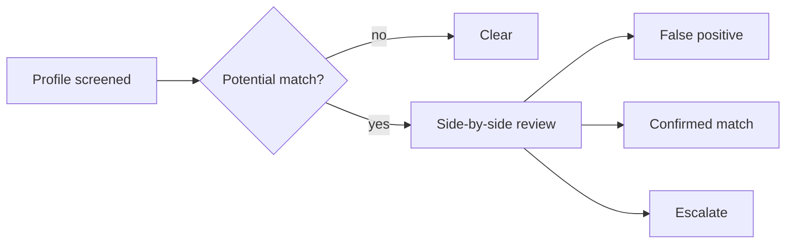

import { PageMeta, LifecycleStepper, ExampleNote, Screenshot } from "/snippets/components.jsx";

<PageMeta tracks={["operations"]} minutes={5} availability="ga" />

<LifecycleStepper current="screen" />

Screening checks the people and organizations you deal with against sanctions lists, politically exposed person (PEP) lists and your own lists. When a name looks like a list entry, Skaletek shows you a potential match to review. You decide whether it is the same person, and your decision is recorded with its reason.

## Why it matters

Paying a sanctioned person is a serious breach, even by accident. Most potential matches turn out to be different people with similar names. Your team needs to clear those quickly and focus on the few that matter.

A recorded decision also protects you later. When the same customer is screened again, a match you already cleared does not come back. When an examiner asks why you paid out to a near match, the comparison and your reason are on file.

## How it works

### Sanctions and PEP screening

Skaletek screens a person or organization when they are onboarded, when a rule asks for it, on a schedule you set, or when you select **Screen entity** on a profile or start a **New screening**. You choose which lists each check uses, such as sanctions lists, PEP lists, or a combination.

A screening run either comes back clear or produces one or more potential matches. Each potential match waits under **Screening** for a decision.

### Reviewing a potential match

The match detail puts your customer and the list entry side by side: names, date of birth, nationality, addresses and identifiers. You compare them and choose a decision with one of three buttons:

| Decision | Meaning |
| --- | --- |
| **Mark as false positive** | A different person or organization. The match shows as **False positive**. The same entry is not raised again for this customer. |
| **Confirm match** | The customer is the person on the list. The match shows as **Confirmed match**. The profile gets a label such as sanctioned or PEP, which rules can act on. |
| **Escalate** | You cannot decide alone. A senior reviewer takes over. The match shows as **Escalated**. |

Every decision needs a reason. An alert linked to a pending match cannot be closed until the match is decided.

### Lists

Besides the lists Skaletek provides, you can keep your own. You manage them under **Settings** › **Configuration** › **Watchlists**, on the **Lists** page, with **Create list**. There are three kinds:

- **Entity** lists hold people and organizations, such as an internal blocklist. Screening compares names against them, so similar spellings are found.
- **Country** lists hold countries, such as high-risk jurisdictions. Rules check whether a country in an event is on the list.
- **Value** lists hold exact values, such as blocked wallet numbers or keywords. Rules check whether an event contains one of them.

Being on a list does nothing by itself. Your rules and screening decisions decide what happens next.

### Re-screening

Lists change, and so do your customers. Skaletek screens a customer again when their name, date of birth, nationality or country changes, and on the schedule you set. Earlier false-positive decisions still apply, so you only review what is new. Adding an entry to a list does not start a new screening by itself; the next scheduled, event-triggered or manual run uses it.

## What you get

- A **Screening** inbox of potential matches waiting for a decision.
- A side-by-side comparison for every potential match.
- A recorded decision and reason for every match, kept for examiners.
- Your own entity, country and value lists, used by screening and rules.
- A screening history for each customer.

<Screenshot name="screening-match-detail-compare" alt="Side-by-side comparison of Moussa Ndiaye and the fictional sample-list entry, showing different dates of birth and nationalities, which is why the analyst can clear the match" />

## Where it appears in the 360° view

You can screen a customer from their profile with **Screen entity**. Every run and every decision is listed under **Screening**. The profile header shows flags such as PEP or sanctioned once a match is confirmed. Alerts linked to a match show it in a screening panel. See [The 360° view](/get-started/360-view).

## See it in the remittance example

<ExampleNote />

Moussa Ndiaye receives the transfers. His name nearly matches an entry on a clearly labelled sample sanctions list; the entry is fictional. The analyst opens the match and compares the two side by side. The dates of birth and nationalities differ, so the analyst selects **Mark as false positive** and gives that reason.

Follow it in [Screen and clear a match](/tutorial/screen-and-clear-a-match).

## In this section

- Sanctions and PEP screening
- Reviewing a potential match
- Lists: entity, country and value lists
- Re-screening

## Related

- [Onboarding overview](/guides/onboarding/overview)
- [Customer 360° overview](/guides/customer-360/overview)
- [Alerts overview](/guides/alerts/overview)
- [Screen and clear a match](/tutorial/screen-and-clear-a-match)
- [Glossary](/glossary)
