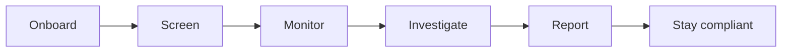

import { AGENT, PageMeta, ExampleNote } from "/snippets/components.jsx";

<PageMeta tracks={["operations", "configure", "build"]} minutes={4} availability="ga" />

Skaletek helps you know your customers and the businesses you work with, and act when something looks wrong. You follow each customer (a person) and each counterparty (an organization) in one continuous view. That view starts when you onboard them and stays with them for as long as you work together.

## One platform, the whole customer lifecycle

Skaletek covers six stages. Each stage adds what it learns to the same customer profile, so nothing gets lost between teams or tools.

| Stage | What you do |
| --- | --- |
| **Onboard** | Verify people with know your customer (KYC) checks and organizations with know your business (KYB) checks, including who owns and controls them. |
| **Screen** | Check names against sanctions lists and lists of politically exposed persons (PEPs), and record your decision on each potential match. |
| **Monitor** | Watch transfers, payments and other activity against rules and thresholds you set, for anti-money laundering (AML), fraud and operational risk. |
| **Investigate** | Read why an alert was raised, then gather the evidence in a case and record your findings. |
| **Report** | Draft, review and file reports to authorities, such as a suspicious transaction report (STR). |
| **Stay compliant** | Follow regulatory change and see which of your controls each obligation affects. |

The place where all of this comes together is the customer profile. Read [The 360° customer view](/get-started/360-view) to see what it holds.

## See it in one story

These docs follow one fictional company from start to finish. Teranga Transfer is a money transfer company in Senegal. Over six days, three senders in France and Italy send five transfers to the same man in Dakar, Moussa Ndiaye. Each transfer stays just under the declaration threshold of 5,000,000 West African CFA francs (XOF).

<ExampleNote />

The story shows what Skaletek does, rather than telling you:

- **You see everything about Moussa in one place.** His profile shows the three senders, the payout agent that paid most of his transfers in cash, his cleared screening match and the open case.
- **You set the rules.** The rule that catches the pattern and its 5,000,000 XOF threshold are settings Teranga owns and can change.
- **Automation does the groundwork, and a person decides.** {AGENT}, the AI assistant (in preview), gathers the evidence and drafts a case summary. The money laundering reporting officer (MLRO) decides whether there is suspicion and approves the report.
- **Every alert is explained.** The alert names the rule, the threshold, the time window and the exact transfers that triggered it.

## Pick your track

Choose the path that matches your role. You can switch at any time.

<CardGroup cols={3}>
  <Card title="Compliance & Operations" icon="user-shield" href="/get-started/tracks/operations">
    Review alerts, investigate cases, file reports and prove compliance. No code.
  </Card>
  <Card title="Configure" icon="sliders" href="/get-started/tracks/configure">
    Describe your data, write and test rules, set thresholds and manage your team.
  </Card>
  <Card title="Build" icon="code" href="/get-started/tracks/build">
    Connect your systems: API keys, events, webhooks and the API reference.
  </Card>
</CardGroup>

## Start with the 15-minute tour

<Card title="Take the 15-minute tour" icon="route" href="/get-started/tour">
  Follow Moussa's five transfers from the first alert to the filed report, with screenshots at every stop.
</Card>

## Try Skaletek

[Start free trial](https://app.skaletek.example/signup) to try Skaletek yourself, or [book a demo](https://skaletek.example/book-a-demo) to see it with our team.
