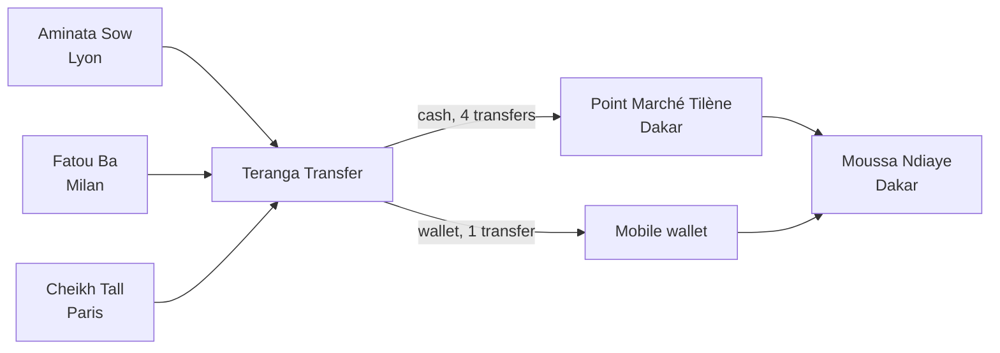

import { PageMeta, ExampleNote, PreviewNotice, TryIt, KeyTakeaway, Screenshot } from "/snippets/components.jsx";

<PageMeta tracks={["operations", "configure", "build"]} minutes={4} availability="ga" />

**In this chapter:** you meet Teranga Transfer, the people who send and receive its money, and the pattern hidden in five ordinary transfers.
Every later chapter follows this one story from signup to a filed report. **Time:** 4 minutes.

<ExampleNote />

## The story

Teranga Transfer is a licensed money transfer company in Senegal. Its customers live in France and Italy and send money home. Teranga pays the money out in Senegal, in cash at partner agents or to mobile wallets. Amounts are in West African CFA francs (XOF).

Teranga is supervised by the BCEAO (Banque Centrale des États de l'Afrique de l'Ouest, the regional central bank). It files suspicion reports with CENTIF-GN, the financial intelligence unit set up for this example, in a suspicious transaction report (STR). In French, the report is a _déclaration de soupçon_.

You play Teranga's compliance team. Over six days, five transfers reach the same man in Dakar. Each one looks normal on its own. Together, they tell a different story.

## The cast

Six fictional people and businesses appear in every chapter, screenshot and sample file. Their identifiers start with `SAMPLE-`, so you can always tell sample data from real data.

| Who | Kind | Where | Role in the story | Sample identifier |
| --- | --- | --- | --- | --- |
| **Aminata Sow** | Person, sender | Lyon, France | Onboarded through Teranga's app with an identity check. Sends money to her brother Moussa. | Passport `SAMPLE-P-0001` |
| **Moussa Ndiaye** | Person, recipient | Dakar, Senegal | Receives all five transfers. His name nearly matches an entry on a sample sanctions list. | National ID `SAMPLE-CNI-0002` |
| **Fatou Ba** | Person, sender | Milan, Italy | Recently onboarded. Sends money to Moussa. | Passport `SAMPLE-P-0003` |
| **Cheikh Tall** | Person, sender | Paris, France | Recently onboarded. Sends money to Moussa. | Passport `SAMPLE-P-0004` |
| **Point Marché Tilène** | Organization, payout agent | Dakar, Senegal | Partner agent, onboarded with a business check. Pays most of Moussa's transfers in cash. | RCCM `SAMPLE-RCCM-0005` |
| **Ibrahima Fall** | Person | Dakar, Senegal | Beneficial owner of Point Marché Tilène. | National ID `SAMPLE-CNI-0006` |

Moussa is Aminata's brother. Fatou and Cheikh have no stated link to Moussa. That is what makes the pattern worth a look.

## The five transfers

| Reference | Day | Sender | Amount | Payout |
| --- | --- | --- | --- | --- |
| `SAMPLE-REMIT-0001` | 1 | Aminata Sow | 4 750 000 XOF | Cash at Point Marché Tilène |
| `SAMPLE-REMIT-0002` | 2 | Fatou Ba | 4 600 000 XOF | Mobile wallet |
| `SAMPLE-REMIT-0003` | 3 | Cheikh Tall | 4 950 000 XOF | Cash at Point Marché Tilène |
| `SAMPLE-REMIT-0004` | 5 | Aminata Sow | 4 800 000 XOF | Cash at Point Marché Tilène |
| `SAMPLE-REMIT-0005` | 6 | Fatou Ba | 4 900 000 XOF | Cash at Point Marché Tilène |

Teranga's declaration threshold in this example is 5 000 000 XOF, a simplified illustration. Every transfer stays just below it. In six days, Moussa receives 24 000 000 XOF from three senders, and four of the five transfers are paid in cash at the same agent.

## What you will see, chapter by chapter

Each chapter shows one capability. It ends with what that capability adds to the 360° view of Moussa: one page that brings together everything known about a customer.

| # | Chapter | What you see |
| --- | --- | --- |
| 1 | [Sign up and set up](/tutorial/sign-up-and-set-up) | A free trial, the setup wizard, the remittance starter pack, and the regulations that apply to Teranga |
| 2 | [Describe your transfers](/tutorial/describe-your-transfers) | The _Remittance transfer_ template and how senders and recipients become customer profiles |
| 3 | [Onboard a sender](/tutorial/onboard-a-sender) | Aminata's identity check: document, selfie, result |
| 4 | [Onboard a partner agent](/tutorial/onboard-a-partner-agent) | Point Marché Tilène's business check and its beneficial owner, Ibrahima Fall |
| 5 | [Screen and clear a match](/tutorial/screen-and-clear-a-match) | Moussa's near match on the sample sanctions list, cleared as a false positive |
| 6 | [Send transfers](/tutorial/send-transfers) | The five transfers arriving from a spreadsheet or through the API |
| 7 | [An alert, explained](/tutorial/an-alert-explained) | The alert on Moussa, with the values, the time window and the transfers behind it |
| 8 | [See the whole picture](/tutorial/see-the-whole-picture) | Moussa's profile: three senders, one agent, a timeline and a relationship graph |
| 9 | [The assistant prepares the case](/tutorial/assistant-prepares-the-case) | A case opened from the alert (preview), with a draft summary for the analyst to review |
| 10 | [Decide and report](/tutorial/decide-and-report) | The suspicion decision (preview) and an STR filed with CENTIF-GN |
| 11 | [When the rules change](/tutorial/when-the-rules-change) | A fictional new instruction lowers the threshold, and you test the impact before you apply it |
| 12 | [Prove it](/tutorial/prove-it) | The trail from regulation to rule to alert to report, ready for an examiner |

Chapters 1 and 2 suit people who set up the platform. Chapters 3 to 5 and 7 to 10 suit analysts and compliance officers. Chapter 6 has a path for both, plus an API tab for developers. [Pick your track](/get-started/pick-your-track) if you want only the chapters for your role.

## How long it takes

The full tutorial takes about an hour, at four to ten minutes per chapter. Each chapter stands on its own, so you can stop and come back.

Short on time? The [15-minute tour](/get-started/tour) covers the key moments of the story in one page.

## How to follow along

You can read every chapter without an account. To click along in the product, use a free trial with the remittance starter pack. The pack installs Teranga's setup and, in one action, loads the whole cast and the five transfers as sample data.

<PreviewNotice feature="Free trial signup, starter packs and sample data" />

Sample data carries a Sample badge everywhere it appears. It does not count towards your plan limits, and you can remove it in one action.

<TryIt>
1. Select Start free trial with this example. The remittance starter pack is pre-selected for you.
2. Complete the setup wizard, then keep Load sample data checked on the last screen.
3. Open **Entities** and search for Moussa Ndiaye. You see his profile with the Sample badge.
</TryIt>

<KeyTakeaway>
One fictional company, six people and businesses, and five transfers carry you through the whole platform. Each transfer is unremarkable alone; the pattern only shows when you see them together.
</KeyTakeaway>

## Where it shows in the 360° view

Everything in this story ends up on Moussa's profile: the transfers he receives, the people who send them, the agent who pays him and the checks run on his name. Chapter 8 walks through that profile in full. Read [The 360° view](/get-started/360-view) to see how the page is organized.

<Screenshot name="entities-profile-moussa-overview" alt="Moussa Ndiaye's profile with the Sample badge, showing his transfers, three senders and one payout agent on a single page" />

## Next

- Next chapter: [Sign up and set up](/tutorial/sign-up-and-set-up)
- Go deeper: [Take the 15-minute tour](/get-started/tour)
