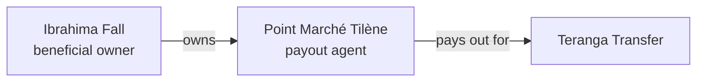

import { PageMeta, ExampleNote, TryIt, KeyTakeaway, Screenshot } from "/snippets/components.jsx";

<PageMeta tracks={["operations"]} minutes={6} availability="ga" />

**In this chapter:** you review the know your business (KYB) file of Point Marché Tilène, the partner agent that pays out most of Moussa's transfers.
You see its registry details, its beneficial owner Ibrahima Fall and the ownership graph that ties them together. **Time:** 6 minutes.

<ExampleNote />

## What happens in the story

Teranga Transfer pays cash through partner agents in Senegal. An agent handles Teranga's money and Teranga's customers, so Teranga must know who the business is and who owns it. Point Marché Tilène, a shop in Dakar, is one of those agents. Before it pays out its first transfer, Teranga onboards it with a KYB check.

## The registry details

The KYB file starts with who the business is. For Point Marché Tilène, it records:

| Detail | Value |
| --- | --- |
| Name | Point Marché Tilène |
| Relationship with Teranga | **Agent** (payout agent) |
| Trade register number (RCCM, _Registre du commerce et du crédit mobilier_) | `SAMPLE-RCCM-0005` |
| National business identification number (NINEA) | `SAMPLE-NINEA-0005` |
| Location | Dakar, Senegal |

Each value shows where it came from: a registry document, a form the agent filled in, or an analyst. When a value supplied by the agent differs from the registry document, the file highlights the difference for you to resolve.

## The beneficial owner

A beneficial owner is the person who ultimately owns or controls a business. For Point Marché Tilène, that is Ibrahima Fall, who lives in Dakar.

Ibrahima confirms his own details through his own identity check. Nobody else can complete it for him. Like every person and business in the file, he is screened against sanctions lists before the file can be approved.

## The ownership graph

The file shows ownership as a graph: who owns or controls whom. Point Marché Tilène's graph is simple.

Larger groups can have several layers of companies between the business and its owners. The graph then works out who the beneficial owners are, and shows a separate view for sanctions ownership rules. You switch between the two views; neither result is hidden.

<Screenshot name="onboarding-kyb-pointmarche-graph" alt="Point Marché Tilène's ownership graph with Ibrahima Fall as beneficial owner, and the view switch between beneficial owners and sanctions ownership" />

## The decision

Before you approve, the file checks that it is complete. Every person and business in the graph must be screened, and ownership shares must add up. If anything is missing, **Approve** stays disabled and a blocker list tells you what to finish and who must do it.

When you approve, the file is frozen as a version. Later changes open a new version, so you can always show what was true when you approved. Point Marché Tilène's profile is labelled as KYB-verified.

<TryIt>
1. Go to **Verifications** › **Company** and open Point Marché Tilène from **Company verifications**.
2. On the **Company data** tab, check the RCCM and NINEA numbers and where each value came from.
3. On the **Ownership** tab, open the **Ownership graph** and select Ibrahima Fall to see his screening result.
</TryIt>

<Accordion title="For developers" icon="code">
  You can start a KYB file and follow its progress through the API, and receive updates by webhook. See the [API reference](/api-reference/introduction).
</Accordion>

<KeyTakeaway>
A partner agent handles your customers' money, so you verify the business and the people behind it. The ownership graph makes who owns Point Marché Tilène visible at a glance.
</KeyTakeaway>

## Where it shows in the 360° view

Point Marché Tilène's company verification keeps the frozen ownership graph, the version history and, on the **KYC sessions** tab, the linked identity check of Ibrahima Fall. On Moussa's profile, the agent appears as the payout point for four of his five transfers. From there, one click takes you to the agent's owner.

<Screenshot name="entities-profile-pointmarche-kyb-tab" alt="Point Marché Tilène's company verification: approved status, the frozen ownership graph and Ibrahima Fall's linked identity check" />

## Next

- Next chapter: [Screen and clear a match](/tutorial/screen-and-clear-a-match)
- Go deeper: [Onboarding](/guides/onboarding/overview)
