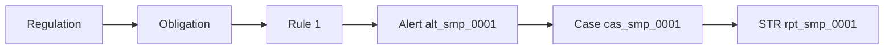

import { PageMeta, ExampleNote, PreviewNotice, TryIt, KeyTakeaway, Screenshot } from "/snippets/components.jsx";

<PageMeta tracks={["operations"]} minutes={7} availability="ga" />

**In this chapter** (about 7 minutes): an examiner visits Teranga Transfer and asks how it meets its obligations.
You answer with three things: the traceability matrix, the dashboards and an examiner export of the case.

<ExampleNote />

## What happens in the story

Some weeks later, the supervisor sends an examiner. The examiner does not want promises. They want to see which requirement each control serves, what the controls found, and what was done about it. For Moussa Ndiaye, the answer runs through every chapter so far.

## The traceability matrix

<PreviewNotice feature="The traceability matrix, part of Regulatory compliance," />

The traceability matrix is a table in the regulatory compliance area. Each row follows one requirement: the regulation and article, the obligation, the control that serves it, the data it uses, the report it produces and the person who owns it.

For Teranga Transfer, one row runs from the obligation to report suspicion, through Rule 1 and the _Remittance transfer_ template, to the suspicious transaction report (STR) template for CENTIF-GN. From Rule 1, you open the alert on Moussa, the case and the filed report `rpt_smp_0001`.

An obligation with no control shows a gap badge, so you find weak spots before the examiner does. Filter by regulation, then export the matrix as CSV or PDF for the examination.

<Screenshot name="regulatory-traceability-matrix" alt="The traceability matrix filtered to Teranga Transfer's anti-money laundering obligations, with Rule 1 and the STR template mapped and one gap badge. The examiner sees each requirement and the control that serves it." />

## The dashboards

Dashboards show the volume and the pace of the work. Go to **Dashboard**:

- **Events Today**, **Open Alerts** and **Rule Fired** show the transfers, the one high-severity alert and how often Rule 1 fires.
- On **Cases**, the status chips show the case by status. You also see whether any decision or filing deadline was missed.
- On **Entities**, **Sum of Transactions** ranks profiles; Moussa Ndiaye tops the list by volume received.

Click any bar or row to reach the alerts, cases or profiles behind it. The examiner sees the numbers and the work they summarize.

## The examiner export

<PreviewNotice feature="Examiner export, including its entry in the audit log," />

The examiner asks for the full file on Moussa. Open the case `cas_smp_0001` and export it.

The export gathers the case as it stood at each decision and at closing: the decision and who recorded it, the comments, the tasks, the links to the alert and the five transfers, and a fingerprint of each piece of evidence so you can prove it was not altered. It contains only what you are allowed to see. Without access to filings, the report is left out entirely.

The export is recorded in the audit log, with who downloaded it and when. The download link expires.

<TryIt>
1. Open the traceability matrix (Preview) and find the row for Rule 1.
2. Open **Dashboard** and click the high-severity alert in the **Open Alerts** panel.
3. Open the closed case on Moussa Ndiaye from **Cases** and export it (preview).
</TryIt>

<KeyTakeaway>
Every step of Moussa's story is linked: regulation, obligation, rule, alert, case and report. You prove compliance by opening the links, not by assembling a file by hand.
</KeyTakeaway>

## Where it shows in the 360° view

Moussa's profile is where the examiner's questions start and end. From his **Alerts** tab, every link in the chain is one click away.

<Screenshot name="entities-profile-closed-case" alt="Moussa Ndiaye's profile with its alert in the Alerts tab, linked to the closed case. The whole investigation is reachable from the customer's single view." />

## Next

You have followed Teranga Transfer from sign-up to an examination.

- Review the story in 15 minutes: the [tour](/get-started/tour).
- Choose your path: [Compliance & Operations](/get-started/tracks/operations), [Configure](/get-started/tracks/configure) or [Build](/get-started/tracks/build).
- Go deeper: [Regulatory compliance](/guides/regulatory-compliance/overview), [Dashboards](/guides/dashboards/overview) and [Cases](/guides/cases/overview).
