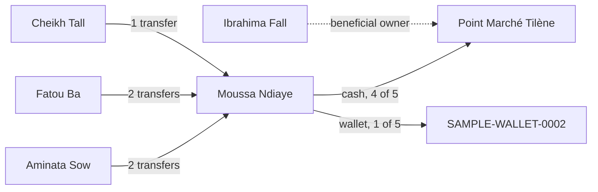

import { PageMeta, ExampleNote, TryIt, KeyTakeaway, Screenshot } from "/snippets/components.jsx";

<PageMeta tracks={["operations"]} minutes={8} availability="ga" />

**In this chapter** (about 8 minutes): you leave the alert and open Moussa Ndiaye's profile, the 360° view of one customer.
You see everything Teranga Transfer knows about him on one page, and where each fact came from.

<ExampleNote />

## What happens in the story

The alert in [chapter 7](/tutorial/an-alert-explained) shows three transfers. The analyst wants the rest of the picture. Who else sends money to Moussa? Where does he collect it? Has anything changed since the alert?

Every person and business in a transfer becomes an **entity** with its own profile. Moussa's profile gathers every transfer, screening result, alert and case that involves him.

## The profile at a glance

The header answers the first questions before you open any tab: Moussa's name, his risk badge, his labels and his entity ID. From the header, **Add label** adds a label and **Screen entity** screens him again. The open alert from chapter 7 is on the **Alerts** tab.

His profile shows the shape of his activity:

| What you see | In the example |
| --- | --- |
| Key figures | 5 transfers received in 6 days, 24,000,000 XOF in total |
| Counterparties | 3 senders: Aminata Sow (2 transfers), Fatou Ba (2) and Cheikh Tall (1) |
| Instruments | One mobile wallet, `SAMPLE-WALLET-0002` |
| Payout | 4 of 5 transfers paid in cash at Point Marché Tilène |
| Countries and corridors | France → Senegal and Italy → Senegal |

Each tile, bar and slice is a link. Click Fatou Ba among his counterparties and you get her transfers to Moussa. Every chart also has a table view.

<Screenshot name="entities-profile-overview" alt="Moussa Ndiaye's entity page on the Details tab: his summary on the left and the Appearances table listing the five transfers he received, TT-REMIT-0001 to TT-REMIT-0005." src="/images/screenshots/entities-detail-moussa.light.en.png" />

## The timeline

The **Appearances** table on the **Details** tab lists every event in which Moussa appears, newest first. It holds all five transfers, including `SAMPLE-REMIT-0004` and `SAMPLE-REMIT-0005`. These arrived after the alert and did not raise a second one. Here they sit next to the others, so nothing escapes the analyst.

Filter by role, date range or status to narrow the list. Each entry opens the transfer and shows any alert it raised.

## Labels

Labels are tags on a profile, such as a risk level or a review status. A rule, a screening review, a person or your own systems can add them.

His profile shows every label Moussa has ever had, not only the active ones. Each label shows who or what added it, the reason, when, and when it expires. Expired and removed labels stay visible, muted, so you can always see what was true before.

## The relationship graph

The **Explore** tab draws who is connected to whom. Moussa sits at the center, tagged **Focal**. Around him are the three senders, the payout agent and his wallet.

Expand Point Marché Tilène and the graph adds Ibrahima Fall, its beneficial owner, from the KYB (know your business) file of [chapter 4](/tutorial/onboard-a-partner-agent). Declared links such as ownership use a different line style from transfer links, so you never confuse the two.

What stands out is what the graph does not show. Aminata is Moussa's sister. Fatou and Cheikh have no stated relationship to him. That is a question for the case.

## Where did this value come from

Every value in the **Summary** on the **Details** tab carries its source. Look at Moussa's address. A badge shows where it came from (a transfer, an identity verification, or a person who edited it), with the date.

Click the history icon next to the address. A drawer opens with each value the field has held. For each value it shows when it was first and last seen, how many events carried it, and its source. Superseded values stay in the list, struck through, never deleted.

This is the answer to the examiner's question "how do you know?" You point at the source.

<Note>
Lineage is different. It records when two profiles were merged into one, or one was split. Moussa's profile has no merges in the sample data.
</Note>

<TryIt>
1. Go to **Entities** and open **Moussa Ndiaye**.
2. On his profile, click Fatou Ba among his counterparties to see her two transfers.
3. On the **Details** tab, find `SAMPLE-REMIT-0005`, the last transfer, in **Appearances**.
4. Open the **Explore** tab and expand Point Marché Tilène to reveal Ibrahima Fall.
5. In the **Summary** on the **Details** tab, open the history of his address and read its source.
</TryIt>

<KeyTakeaway>
One profile holds the whole story of a customer: all five transfers, the three senders, the agent and its owner. Every value tells you where it came from, so you can trust what you read.
</KeyTakeaway>

## Where it shows in the 360° view

This chapter is the 360° view itself. From here, every alert, transfer, screening result and, soon, the case link back to Moussa's profile.

<Screenshot name="entities-profile-relationships" alt="Explore tab of Moussa Ndiaye's profile: three senders, Point Marché Tilène and its beneficial owner Ibrahima Fall. It shows the network an analyst needs before opening a case." />

## Next

- Next chapter: [The assistant prepares the case](/tutorial/assistant-prepares-the-case). Open a case from the alert and let the assistant gather the evidence.
- Go deeper: [Customer 360°](/guides/customer-360/overview).
